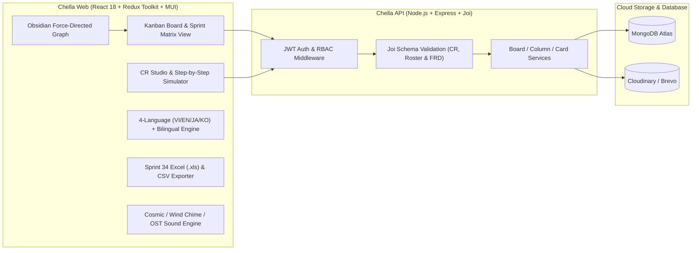

# 🌸 Chella — A clone of "C"onfluence - tr"ELL"o - jir"A"

<div align="center">


**Chella — Sự kết hợp tinh hoa giữa "C"onfluence (Tài liệu đặc tả FRD & Đồ thị tri thức Obsidian) × tr"ELL"o (Bảng Kanban trực quan) × jir"A" (Quản trị Sprint, Change Request, Resource Point & Mô phỏng luồng kỹ thuật CR Studio).**

[🌐 Trải nghiệm Web App (Vercel)](https://chello-web.vercel.app) • [⚙️ Backend API (Render)](https://chello-api.onrender.com/v1/status)

</div>

---

## ✨ Điểm Nhấn Nổi Bật (Key Highlights — v4.0.0)

### 1. 🧭 Cấu Trúc Quản Trị Chuẩn Hóa: `Board = Sprint` • `Column = Chủ đề CR` • `Card = CR`
- **Đồng bộ 1:1 với File Excel / CSV Template Sprint 34 (`22/10/2026 – 05/11/2026`)**:
  - **Khung Metadata Sprint & Đội ngũ (`Top Section`)**:
    - `Sprint: 34`, `Start date: 22/10/2026`, `End date: 05/11/2026`, `Update till: 26/10/2026`, `By: Dao Thanh Phuc`, `Note`.
    - Hệ thống trạng thái chuẩn (`Status`): `Processing`, `In testing`, `Blocking`, `Ready for deploy`, `Deployed`, `Done testing`.
    - Bảng phân bổ `Handle by` & `Resource point`: Hỗ trợ gắn trực tiếp các thành viên trong đội dự án (`Lam Chi Kien`, `Phan Nguyen Song Toan`, `Ho Thao Dieu`, `Nguyen Phuoc Long`, `Nguyen Khanh Duy`, `Hoang Vinh Son`, `Bui Hoang Gia Phuc`, `Vo Viet Binh` hoặc thêm nhân sự mới bất kỳ) **ngay cả khi nhân sự chưa có tài khoản đăng nhập**.
  - **Bảng Chi Tiết Change Request (`Bottom Table`)**:
    - Đầy đủ 8 cột chuẩn: `Ticket ID` (VD: `BNPL-945`), `CR Description` (`Usage Limit - Monthly 1 time synchronized update for user`), `Status` (`Ready for deploy`), `Handle by` (`Ho Thao Dieu, Hoang Vinh Son`), `Due date for dev` (`5/11`), `Dev Progress` (`1`), `Resource used` (`1`), `Note`.
  - **Xuất & Nhập Báo Cáo 1-Click**:
    - Xuất trực tiếp cả **Excel (`.xls`)** có định dạng màu sắc và **CSV (`.csv`)** đúng từng ô như file mẫu.
    - Hỗ trợ **Import file `.md` hoặc `.csv` mẫu Sprint 34** thành CR Ticket chỉ với 1 cú nhấp chuột.

---

### 2. 🕸️ Đồ Thị Tri Thức Obsidian (`Obsidian Graph`) & Trang Riêng Mô Phỏng Kỹ Thuật (`CR Studio`)
- **Đồ Thị Tri Thức Obsidian (`ObsidianGraphView.jsx`)**:
  - Mô phỏng lực tương tác vật lý (`Force-Directed Knowledge Graph`) kết nối trực tiếp:
    - 🟣 **Cột chủ đề CR (`Column / Topic`)**
    - 🔵 **Thẻ Change Request (`Card / CR`)**
    - 🟢 **Nhân sự phụ trách (`Handle by`)**
    - 🟠 **Tài liệu đặc tả (`FRD Document`)**
  - Hỗ trợ cú pháp liên kết hai chiều **`[[Ticket-ID]]` (`WikiLinks`)** ngay trong mô tả Markdown và ghi chú, tự động vẽ đường nối liên kết tri thức giữa các CR.
- **Trang Riêng Mô Phỏng Luồng CR (`CrStudio.jsx` — `/boards/:boardId/cr/:cardId`)**:
  - Không gian toàn màn hình dành riêng cho từng CR để trực quan hóa, kiểm thử kịch bản và mô phỏng luồng hoạt động từng bước (`Step-by-Step Interactive Flow Simulator`):
    - 🟢 **Kịch bản Chuẩn (`Happy Path — 200 OK`)**: Chạy từng bước qua `Client / App` → `API Gateway` → `Usage Limit Engine` → `Core DB & Audit Log` → `Response & Notification`.
    - 🟠 **Kịch bản Chặn Quy Tắc Nghiệp Vụ (`Quota / Business Rule Block — 409 Conflict`)**: Mô phỏng tự động trường hợp user đã đồng bộ hạn mức 1 lần trong tháng (`MONTHLY_SYNC_LIMIT_REACHED`).
    - 🔴 **Kịch bản Xung Đột Đồng Thời & Timeout (`Race / Timeout Rollback — 503`)**: Kiểm tra cơ chế `Idempotency-Key` và tự động rollback giao dịch.
  - Tích hợp **Sơ đồ Kiến trúc & Sequence Diagram**, **Obsidian WikiLink Notes** và **Đồ thị Liên kết Cục bộ (`Local Knowledge Graph`)** ngay trên cùng một trang.

---

### 3. 🌐 Đa Ngôn Ngữ (`VI` • `EN` • `JA` • `KO`) & Chế Độ Song Ngữ (`Bilingual Mode`)
- Chuyển đổi tức thì giữa **4 ngôn ngữ**:
  - 🇻🇳 **Tiếng Việt (`VI`)**
  - 🇬🇧 **English (`EN`)**
  - 🇯🇵 **日本語 (`JA`)**
  - 🇰🇷 **한국어 (`KO`)**
- **Nút Chuyển Đổi Song Ngữ (`Song ngữ / Bilingual`)**: Hiển thị song song bản dịch và thuật ngữ đối chiếu, đồng thời giữ nguyên các thuật ngữ chuyên ngành quốc tế (`Sprint`, `CR`, `FRD`, `Ticket ID`, `Status`, `Handle by`, `Resource point`, `Due date for dev`, `Dev Progress`, `Resource used`, `Kanban`, `Obsidian Graph`, `CR Studio`).

---

### 4. 🎨 7 Chủ Đề Không Gian & Âm Thanh Đa Tầng (Cosmos • Wind Chime • Sora • Furina • Nahida)

| Mã Theme | Chủ Đề Không Gian | Sắc Độ & Bảng Màu Chủ Đạo | Âm Thanh / Nhạc Nền Mặc Định |
| :--- | :--- | :--- | :--- |
| `cosmos` | **🌌 Vũ Trụ & Dải Ngân Hà (`Astral Cosmos • Milky Way & Zodiac`)** | Tối dịu mắt (`#161b33` / `#1e2442`), Vàng ánh sao (`#f5d061`) & Tím tinh vân (`#a78bfa`) | *Cosmic Astral Harmony* (Âm hưởng Vũ trụ & Cung Hoàng Đạo huyền bí, êm dịu) |
| `wind-chime` | **🎐 Bầu Trời Xanh & Chuông Gió (`Azure Breeze • Sky & Wind Chime`)** | Xanh da trời nhạt (`#38bdf8`, `#e0f2fe`) & Xanh lá bạc hà tươi mát (`#34d399`, `#d1fae5`) | *Gentle Breeze & Glass Furin* (Tiếng gió nhẹ thoang thoảng & chuông gió thủy tinh) |
| `sora-sky` | **☁️ Sora Kasugano • Beyond the Distant Sky** | Trắng bạc & Xanh bầu trời (`#7dd3fc`) | *Toui Sora e (遠い空へ)* |
| `furina` | **💧 Furina • Salon Solitaire & Fontaine** | Xanh Hydro Fontaine (`#38bdf8`) | *Sinner's Finale (The Last Rose of the Sinner)* |
| `nahida` | **🌿 Nahida • Sanctuary of Surasthana** | Xanh Ngọc Lục Bảo Sumeru (`#34d399`) | *Sumeru Main Theme (Forest of Jnana & Vidya)* |
| `sora-twilight` | **🎀 Sora Kasugano • Moonlit Black Ribbon** | Đen tuyền & Tím ánh trăng (`#a78bfa`) | *Inori (祈り)* |
| `sora-usagi` | **🐰 Sora & Usagi • Bunny Sanctuary** | Hồng phấn & Thỏ bông Usagi (`#f472b6`) | *Tomadoi no Naka (戸惑いの中)* |

---

## 🏗️ Kiến Trúc Hệ Thống (System Architecture)



---

## 📜 Lịch Sử Phiên Bản & Chi Tiết Thay Đổi (Version History & Changelog)

| Phiên Bản | Cột Mốc | Tóm Tắt Thay Đổi Trọng Tâm |
| :--- | :--- | :--- |
| **`v4.0.0`** | **Chella Rebrand, Obsidian Graph, CR Studio, 4-Lang & Cosmos/Wind-Chime** *(Hiện tại)* | Đổi tên đồng bộ thành **Chella (`"C"onfluence - tr"ELL"o - jir"A"`)**, hỗ trợ 4 ngôn ngữ (`VI`/`EN`/`JA`/`KO`) + chế độ Song ngữ, bổ sung **Đồ thị tri thức Obsidian**, **Trang riêng mô phỏng CR Studio**, 2 chủ đề mới (**Vũ Trụ/Hoàng Đạo** & **Bầu Trời Xanh/Chuông Gió**), đồng bộ 100% file mẫu Excel/CSV Sprint 34 (`BNPL-945`) và gắn nhân sự chưa cần tài khoản. |
| **`v3.0.0`** | **CR/FRD Suite & Multi-Theme OST** | Quản lý CR/FRD chuyên sâu, Import Markdown thành CR Ticket, Xuất Excel Sprint 34 (22/10 - 05/11), Cảnh báo Deadline, mở rộng chủ đề **Furina & Nahida** và trình phát OST. |
| **`v2.2.0`** | **Sora Kasugano Edition & Motion UX** | Thiết kế chủ đề **Sora Kasugano**, bộ icon SVG, Command Palette (`Ctrl+K`), Bento Analytics View và hiệu ứng âm thanh Web Audio API. |
| **`v2.0.0`** | **🌟 Mốc Đặc Biệt: Antigravity Full-Stack Audit** | Khắc phục toàn bộ lỗi kiến trúc & bảo mật, đồng bộ giao dịch kéo thả cột/thẻ, sửa lỗi stale state, hỗ trợ xóa cột/thẻ an toàn và tối ưu hóa triển khai Vercel + Render. |
| **`v1.0.0`** | **Full-Stack Social & Real-time Kanban** (`PR #30` – `#41`) | Hoàn thiện mời thành viên, bình luận thẻ, phân trang tìm kiếm bảng (`AutoCompleteSearchBoard`), thông báo thời gian thực với `Socket.io` và `ActiveCard` Modal. |
| **`v0.5.0`** | **Authentication & User Settings** (`PR #20` – `#29`) | Xây dựng đăng ký/đăng nhập, xác thực tài khoản qua email, `axios` interceptors tự động làm mới token (`refreshToken`), bảo vệ route (`ProtectedRoute`) và trang hồ sơ cá nhân. |
| **`v0.1.0`** | **Core Kanban & Drag-and-Drop Engine** (`PR #8` – `#19`) | Khởi tạo giao diện Kanban, tích hợp `@dnd-kit` kéo thả Column/Card mượt mà, xử lý `PlaceholderCard` khi cột rỗng và kết nối API cơ bản. |

---

## 🛠️ Hướng Dẫn Cài Đặt & Chạy Dự Án (Local Development)

```bash
# 1. Cài đặt dependencies
yarn install

# 2. Chạy môi trường Development (http://localhost:5173)
yarn dev

# 3. Kiểm tra quy chuẩn code (ESLint)
yarn lint

# 4. Build bản Production
yarn build
```
