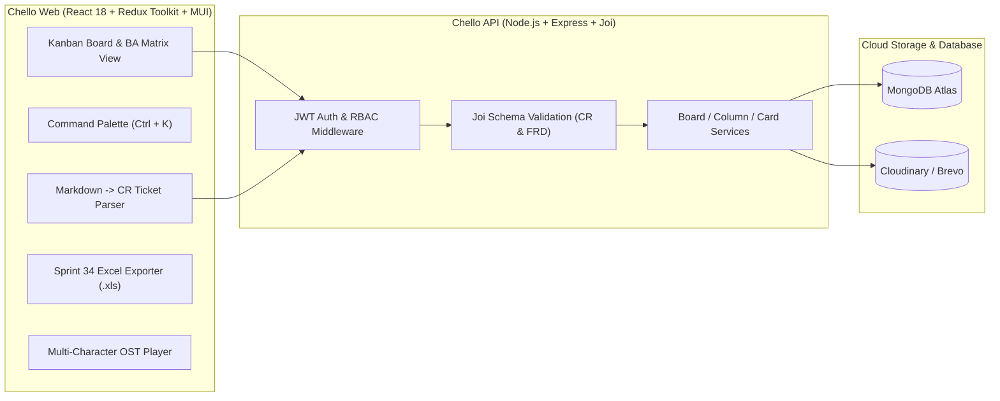

# 🌸 Chello Web — Business Analyst (BA) & Anime Workspace Platform

<div align="center">


**Nền tảng Quản trị Change Request (CR), Tài liệu Nghiệp vụ (FRD) & Tiến độ Sprint dành cho Business Analyst — Kết hợp phong cách nghệ thuật Anime Nhật Bản (Sora Kasugano • Furina • Nahida).**

[🌐 Trải nghiệm Web App (Vercel)](https://chello-web.vercel.app) • [⚙️ Backend API (Render)](https://chello-api.onrender.com/v1/status)

</div>

---

## ✨ Điểm Nhấn Nổi Bật (Key Highlights)

### 1. 📋 Bộ Công Cụ Chuyên Biệt Cho Business Analyst (BA Powerhouse — Jira × Trello × Confluence)
- **Theo dõi Change Request (CR) theo Chu kỳ Sprint 2 Tuần**:
  - Hỗ trợ cấu hình kỳ Sprint trực tiếp trên Board (mặc định **Sprint 34: 22/10/2026 – 05/11/2026**).
  - Mỗi thẻ công việc là một **CR Ticket** hoàn chỉnh với các trường chuyên dụng: **Mã CR** (`BNPL-1`, `BNPL-2`, ...), **Kỳ Sprint**, **Người phụ trách (PIC)**, **Trạng thái BA** (`In Analysis`, `FRD Review`, `In Dev`, `In SIT/UAT`, `Done`, `Blocked`), **Deadline** và **Note cần thiết**.
- **Quản lý Tài liệu FRD (Functional Requirement Document) & Mô hình hóa Hệ thống**:
  - **Upload & Download 1-Click**: Đính kèm trực tiếp các file `.md`, `.pdf`, `.docx`, `.txt`, `.json` (bao gồm cả các file đặc tả sinh ra từ **Antigravity** hoặc tải lên từ máy tính) vào từng CR và tải về bất cứ lúc nào.
  - **Khung FRD Chuẩn BA & Sơ đồ Mermaid**: Tích hợp nút **Chèn khung FRD chuẩn BA** gồm 6 phần (Bối cảnh As-Is/To-Be, Phân quyền Actors, Business Rules, Sơ đồ Sequence Diagram, Data Dictionary và UAT Acceptance Criteria).
  - **Liên kết Tri thức Hệ thống (Knowledge Linking)**: Liên kết các CR có chung luồng nghiệp vụ hoặc phụ thuộc lẫn nhau (`linkedCardIds`) và di chuyển tức thì giữa các CR.
- **Import File Markdown (`.md`) Thành CR Ticket**:
  - Tải lên file `.md` hoặc dán nội dung Markdown để hệ thống tự động bóc tách **Mã CR**, **Tên CR**, **Deadline**, **Subtasks / UAT Checklist** (`- [ ] ...`) và đính kèm luôn bản gốc vào mục **Tài liệu FRD**.
- **Xuất Báo Cáo Excel (`.xls`) Chuẩn Báo Cáo Tiến Độ Sprint**:
  - Xuất ngay file Excel có định dạng bảng biểu chuyên nghiệp, hỗ trợ đầy đủ tiếng Việt UTF-8, tô màu cảnh báo tự động theo hạn hoàn thành với đầy đủ các cột:
    1. **STT**
    2. **Kỳ Sprint** (VD: `Sprint 34`)
    3. **Thời gian bắt đầu** (`22/10/2026`)
    4. **Thời gian kết thúc** (`05/11/2026`)
    5. **Được cập nhật tới ngày mấy** (Tự động lấy ngày xuất báo cáo `DD/MM/YYYY`)
    6. **Mã CR** (VD: `BNPL-1`)
    7. **Tên CR**
    8. **Người phụ trách (PIC)**
    9. **Trạng thái (Status)**
    10. **Deadline & Cảnh báo**
    11. **Note cần thiết (Ghi chú BA / FRD / Subtasks)**
- **Theo Dõi Tiến Độ & Cảnh Báo Deadline Sớm**:
  - Tự động tính toán và gắn nhãn cảnh báo trên từng thẻ CR và tại **Trung tâm Cảnh báo Hạn (`BoardBar`)**:
    - 🔴 **Quá hạn (`Overdue`)**: Viền đỏ cảnh báo khi CR vượt quá ngày Deadline.
    - 🟠 **Sắp đến hạn (`Due Soon ≤ 2 ngày`)**: Nhắc nhở sớm các CR cần ưu tiên chốt FRD / UAT.
    - 🔵 **Đúng tiến độ (`On Track`)** & 🟢 **Hoàn thành (`Done`)**.

---

### 2. 🎨 Hệ Thống Chủ Đề Nhân Vật & Nhạc Nền OST (Sora • Furina • Nahida)

| Mã Theme | Nhân Vật & Chủ Đề | Tông Màu Chủ Đạo | Bản Nhạc Nền OST Mặc Định |
| :--- | :--- | :--- | :--- |
| `sora-sky` | **Sora Kasugano • Beyond the Distant Sky** (*Yosuga no Sora*) | Trắng bạc & Xanh bầu trời (`#7dd3fc`) | *Toui Sora e (遠い空へ)* |
| `sora-twilight` | **Sora Kasugano • Moonlit Black Ribbon** (*Yosuga no Sora*) | Đen tuyền & Tím ánh trăng (`#a78bfa`) | *Inori (祈り)* |
| `sora-usagi` | **Sora & Usagi • Bunny Sanctuary** (*Yosuga no Sora*) | Hồng phấn & Thỏ bông Usagi (`#f472b6`) | *Tomadoi no Naka (戸惑いの中)* |
| `furina` | **Furina • Salon Solitaire & Fontaine** (*Genshin Impact*) | Xanh Hydro Hoàng gia Fontaine (`#38bdf8`) | *Sinner's Finale (The Last Rose of the Sinner)* |
| `nahida` | **Nahida • Sanctuary of Surasthana** (*Genshin Impact*) | Xanh Ngọc Lục Bảo Sumeru (`#34d399`) | *Sumeru Main Theme (Forest of Jnana & Vidya)* |

- **Trình Phát Nhạc Nền OST Đa Kênh (`AppBar`)**:
  - Hỗ trợ phát trực tuyến các bản OST gốc:
    - **Sora (*Yosuga no Sora* OST)**: *Toui Sora e (遠い空へ)*, *Inori (祈り)*, *Tomadoi no Naka (戸惑いの中)*, *Kioku (記憶)*.
    - **Furina (*Fontaine* OST)**: *Sinner's Finale (The Last Rose of the Sinner)*, *Fontaine Main Theme*.
    - **Nahida (*Sumeru* OST)**: *Sumeru Main Theme*, *Whirling of Leaves and Petals*.
  - Hỗ trợ **chọn file nhạc cá nhân (`.mp3`, `.wav`, `.ogg`)** từ máy tính và cơ chế **Music Box Synthesizer (Web Audio API)** dự phòng khi ngoại tuyến.
- **Trải Nghiệm Tương Tác Hiện Đại**:
  - **Command Palette (`Ctrl + K`)**: Tìm kiếm nhanh theo Mã CR (`BNPL-1`), xuất Excel Sprint, đổi chủ đề nhân vật hoặc chuyển bài nhạc OST chỉ bằng bàn phím.
  - **BA Matrix & Analytics View**: Chuyển đổi tức thì giữa giao diện kéo thả **Kanban** và bảng ma trận **BA Matrix & Overview**.

---

## 🏗️ Kiến Trúc Hệ Thống (System Architecture)



---

## 📜 Lịch Sử Phiên Bản & Chi Tiết Thay Đổi (Version History & Changelog)

Dự án được phát triển qua **2 giai đoạn lớn**:
1. **Giai đoạn Nền tảng (`v0.1.0` → `v1.0.0`)**: Xây dựng từ đầu qua 41 nhánh tính năng & Pull Requests (`PR #8` → `PR #41`).
2. **Mốc Đặc Biệt — Đồng hành nâng cấp cùng Antigravity (`v2.0.0` → `v3.0.0`)**: Tái cấu trúc bảo mật, hiệu năng, thiết kế giao diện Anime Nhật Bản và nâng cấp thành nền tảng chuyên dụng cho **Business Analyst (BA)**.

### Bảng Tóm Tắt Các Phiên Bản Chính

| Phiên Bản | Cột Mốc | Tóm Tắt Thay Đổi Trọng Tâm |
| :--- | :--- | :--- |
| **`v3.0.0`** | **BA Powerhouse & Multi-Character OST** *(Hiện tại)* | Quản lý CR/FRD chuyên sâu, Import Markdown thành CR Ticket, Xuất Excel Sprint 34 (22/10 - 05/11), Cảnh báo Deadline, mở rộng chủ đề Chibi **Furina & Nahida** và trình phát OST thực tế. |
| **`v2.2.0`** | **Sora Kasugano Edition & Motion UX** | Thiết kế chủ đề **Sora Kasugano (*Yosuga no Sora*)**, bộ icon SVG thỏ bông Usagi & ruy-băng đen, Command Palette (`Ctrl+K`), Bento Analytics View và hiệu ứng âm thanh Web Audio API. |
| **`v2.1.0`** | **Anime Aesthetics & Interactive Workspace** | Nâng cấp giao diện Glassmorphism, hệ thống nhãn nguyên tố, Checklist tiến độ, Pomodoro Focus Timer, bộ lọc thẻ và 1-Click Board Templates. |
| **`v2.0.0`** | **🌟 Mốc Đặc Biệt: Antigravity Full-Stack Audit** | Khắc phục toàn bộ lỗi kiến trúc & bảo mật, đồng bộ giao dịch kéo thả cột/thẻ, sửa lỗi stale state, hỗ trợ xóa cột/thẻ an toàn và tối ưu hóa triển khai Vercel + Render. |
| **`v1.0.0`** | **Full-Stack Social & Real-time Kanban** (`PR #30` – `#41`) | Hoàn thiện mời thành viên, bình luận thẻ, phân trang tìm kiếm bảng (`AutoCompleteSearchBoard`), thông báo thời gian thực với `Socket.io` và `ActiveCard` Modal. |
| **`v0.5.0`** | **Authentication & User Settings** (`PR #20` – `#29`) | Xây dựng đăng ký/đăng nhập, xác thực tài khoản qua email, `axios` interceptors tự động làm mới token (`refreshToken`), bảo vệ route (`ProtectedRoute`) và trang hồ sơ cá nhân. |
| **`v0.1.0`** | **Core Kanban & Drag-and-Drop Engine** (`PR #8` – `#19`) | Khởi tạo giao diện Trello, tích hợp `@dnd-kit` kéo thả Column/Card mượt mà, xử lý `PlaceholderCard` khi cột rỗng và kết nối API cơ bản. |

---

### Chi Tiết Thay Đổi Từng Phiên Bản & Lịch Sử Merge Branch

<details open>
<summary><b>🚀 v3.0.0 — Business Analyst (BA) CR/FRD Suite, Sprint 34 Excel & Multi-Character OST (2026-10-29)</b></summary>

- **Quản trị Change Request (CR) & Chu kỳ Sprint**:
  - Bổ sung hệ thống trường dữ liệu BA trên thẻ: `crCode` (VD: `BNPL-1`), `sprint` (`Sprint 34`), `assignee` (`Người phụ trách`), `baStatus` (`In Analysis`, `FRD Review`, `In Dev`, `In SIT/UAT`, `Done`, `Blocked`), `deadline` và `note`.
  - Hỗ trợ cấu hình kỳ Sprint 2 tuần trên `BoardBar` (mặc định **Sprint 34: 22/10/2026 – 05/11/2026**).
- **Quản lý Tài liệu FRD & Liên kết Kiến thức**:
  - Hỗ trợ đính kèm (`Upload`) và tải xuống (`Download`) các file FRD (`.md`, `.pdf`, `.docx`, `.txt`, `.json`) trực tiếp trong từng CR.
  - Bổ sung tính năng **Import Markdown → CR Ticket** (`ImportMarkdownModal.jsx`) tự động phân tích tiêu đề, mã CR, checklist và đính kèm file FRD.
  - Bổ sung tính năng **Liên kết CR (`linkedCardIds`)** giúp kết nối các ticket có liên quan về mặt nghiệp vụ.
- **Xuất Báo cáo Excel Sprint (`excelExporter.js`) & Cảnh báo Deadline**:
  - Xuất file `.xls` chuẩn Microsoft Excel bao gồm đầy đủ: Kỳ Sprint, Thời gian bắt đầu, Thời gian kết thúc, Ngày cập nhật, Mã CR, Tên CR, Người phụ trách, Trạng thái, Deadline và Note cần thiết.
  - Thêm huy hiệu cảnh báo hạn hoàn thành trên thẻ và Popover **Cảnh báo hạn** trên thanh công cụ.
- **Mở rộng Chủ đề Nhân vật (Sora • Furina • Nahida) & Trình phát OST**:
  - Bổ sung bộ hình minh họa Chibi & phong cảnh cho **Furina** (*Fontaine*) và **Nahida** (*Sumeru*) bên cạnh 3 chủ đề của **Sora Kasugano**.
  - Tích hợp trình phát nhạc nền OST trực tuyến: *Toui Sora e*, *Inori*, *Tomadoi no Naka*, *Kioku* (Sora); *Sinner's Finale*, *Fontaine Main Theme* (Furina); *Sumeru Main Theme*, *Whirling of Leaves and Petals* (Nahida) kèm tính năng tải file nhạc từ máy tính.
</details>

<details>
<summary><b>🌸 v2.2.0 — Sora Kasugano Aesthetic, Command Palette (Ctrl+K) & Bento Analytics (2026-10-28)</b></summary>

- **Chủ đề Sora Kasugano (*Yosuga no Sora*)**:
  - Thiết kế 3 sắc thái chủ đề (`sora-sky`, `sora-twilight`, `sora-usagi`) lấy cảm hứng từ Sora Kasugano và thỏ bông Usagi.
  - Tự thiết kế bộ biểu tượng vector SVG (`SoraBunnyIcon`, `SoraRibbonIcon`).
- **Tương tác & Chuyển động Hiện đại**:
  - Xây dựng **Command Palette (`Ctrl + K`)** hỗ trợ tìm kiếm thẻ và điều khiển nhanh bằng bàn phím.
  - Xây dựng chế độ xem **Bento Analytics Overview** thống kê tiến độ theo thời gian thực.
  - Thêm hiệu ứng âm thanh tương tác nhẹ nhàng bằng Web Audio API (`soundEffects.js`).
</details>

<details>
<summary><b>🌟 v2.0.0 & v2.1.0 — Mốc Đặc Biệt: Antigravity Security & Architecture Refactor (2026-10-28)</b></summary>

- **Cải tiến Kiến trúc & Độ tin cậy**:
  - Sửa lỗi mất đồng bộ dữ liệu khi kéo thả thẻ giữa các cột (`BoardContent.jsx`).
  - Bổ sung luồng xóa thẻ (`deleteCardDetailsAPI`) và làm mới trạng thái Redux chuẩn xác.
  - Cấu hình biến môi trường linh hoạt `VITE_API_ROOT` cho môi trường Production trên Vercel.
</details>

<details>
<summary><b>🧱 v0.1.0 → v1.0.0 — Lịch Sử Các Nhánh Tính Năng & Pull Requests Ban Đầu (PR #8 → PR #41)</b></summary>

- **Giai đoạn Real-time, Tìm kiếm & Tương tác Thẻ (`PR #30` → `PR #41`)**:
  - `PR #41` (`realTimeInvite`): Tích hợp `Socket.io` xử lý lời mời vào bảng theo thời gian thực.
  - `PR #40` (`inviteUser`): Xây dựng chức năng mời người dùng tham gia Board (`InviteBoardUser.jsx`).
  - `PR #39` (`handleInvitation`): Quản lý thông báo lời mời và phản hồi `Accept / Reject` (`Notifications.jsx`).
  - `PR #38` (`searchBoard`): Tìm kiếm bảng tức thì với `AutoCompleteSearchBoard` và debounce.
  - `PR #37` (`cardMember`): Quản lý thành viên tham gia từng thẻ (`CardUserGroup.jsx`).
  - `PR #36` (`cardComment`): Chức năng bình luận và thảo luận trên thẻ (`CardActivitySection.jsx`).
  - `PR #35` (`cardCover`) & `PR #34` (`cardDescription`): Cập nhật ảnh bìa và trình soạn thảo Markdown (`@uiw/react-md-editor`) cho thẻ.
  - `PR #33` (`updateCardTitle`) & `PR #32` (`activeCard`): Xây dựng `ToggleFocusInput` và cửa sổ chi tiết thẻ `ActiveCard`.
  - `PR #31` (`createBoard`) & `PR #30` (`boardPage`): Xây dựng trang danh sách bảng có phân trang và Modal tạo bảng mới.
- **Giai đoạn Xác thực, Bảo mật & Quản lý Tài khoản (`PR #20` → `PR #29`)**:
  - `PR #29` (`accountSetting`) & `PR #28` (`SettingPage`): Cập nhật thông tin cá nhân, đổi mật khẩu và tải lên ảnh đại diện.
  - `PR #27` (`refreshToken`) & `PR #26` (`protectedRoute`): Tự động làm mới Access Token qua `axios` interceptor và bảo vệ các đường dẫn yêu cầu đăng nhập.
  - `PR #25` (`Logout`) & `PR #24` (`VerifyAccount`): Đăng xuất an toàn và xác thực tài khoản qua liên kết email.
  - `PR #23` (`Persist-Login`), `PR #22` (`Register-Login-API`), `PR #21` (`ActiveBoard-Redux`), `PR #20` (`Auth-UI`): Tích hợp `redux-persist`, Redux Toolkit và giao diện Đăng nhập / Đăng ký.
- **Giai đoạn Khởi tạo & Lõi Kéo Thả Kanban (`PR #8` → `PR #19`)**:
  - `PR #19` (` deleteColumn`) & `PR #18` (`moveCardDifferentColumn`): Xóa cột và đồng bộ API khi di chuyển thẻ sang cột khác.
  - `PR #17` (`moveCardSameColumn`) & `PR #16` (`moveColumn`): Đồng bộ vị trí thẻ và cột sau khi kéo thả.
  - `PR #15` (`createColumnCard`), `PR #14` (`connectApi`), `PR #13` (`fixDndBug`), `PR #8`–`#12`: Thiết lập cấu trúc dự án React + Vite, MUI Theme và tích hợp thư viện `@dnd-kit`.
</details>

---

## 🔮 Định Hướng Phát Triển Tiếp Theo (Upcoming Roadmap)

1. **Phân quyền Tài khoản Chuyên sâu (RBAC)**: Phân tách vai trò `BA Lead`, `Product Owner`, `Developer`, `QC/Tester` trên từng Board và trạng thái phê duyệt FRD (`Sign-off Workflow`).
2. **Tích hợp AI Agent từ Antigravity**:
   - Tự động phân tích yêu cầu nghiệp vụ để gợi ý **Business Rules**, **Edge Cases** và sinh tự động **Subtasks / Test Cases UAT**.
   - Tự động chuyển đổi biên bản họp hoặc ghi chú thô thành tài liệu **FRD chuẩn hóa** kèm sơ đồ hệ thống.

---

## 🛠️ Hướng Dẫn Cài Đặt & Chạy Dự Án (Local Development)

```bash
# 1. Cài đặt dependencies
yarn install

# 2. Chạy môi trường Development (http://localhost:5173)
yarn dev

# 3. Kiểm tra quy chuẩn code (ESLint)
yarn lint

# 4. Build bản Production
yarn build
```
