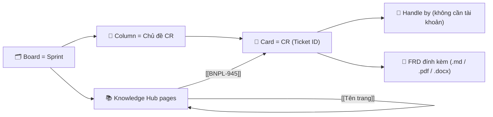
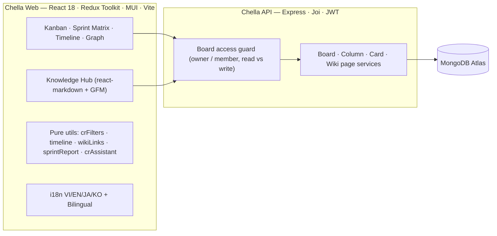

# 🌸 Chella — A clone of "C"onfluence - tr"ELL"o - jir"A"

<div align="center">


**Confluence (Knowledge Hub & FRD) × Trello (Kanban trực quan) × Jira (Sprint, CR, Timeline, Quick Filters, Report) — gói gọn trong một không gian làm việc nhiều chủ đề, đa ngôn ngữ.**

[🌐 Web App (Vercel)](https://chello-web.vercel.app) • [⚙️ Backend API (Render)](https://chello-api.onrender.com/v1/status) • [🧩 Backend repo](https://github.com/phuckid28/chello-api)

</div>

---

## 🚀 Có gì mới trong `v5.0.0` — *Knowledge & Delivery Release*

| | Tính năng | Lấy cảm hứng từ | Bạn dùng nó để… |
| :---: | :--- | :--- | :--- |
| 📚 | **Knowledge Hub** (`/boards/:boardId/wiki`) | Confluence + Obsidian | Viết biên bản họp, FRD, Decision Log, Glossary, Retro, Release Note theo **cây trang**; liên kết `[[BNPL-945]]` tới CR và `[[Tên trang]]` tới trang khác; xem **Backlinks**, **Outgoing links** và **Mục lục** tự động. Tự lưu sau 1.2s, `Ctrl + S` để lưu ngay. |
| 🗓️ | **Timeline view** | Jira Timeline / Gantt | Xem mọi CR trên trục thời gian của Sprint (Start date → Due date for dev), vạch **Hôm nay**, nhóm theo **Chủ đề CR** hoặc **Handle by**, thanh tiến độ Dev Progress ngay trong bar. |
| 🔎 | **Quick Filters** | Jira quick filters | Lọc đồng thời theo **Handle by** (kể cả *Chưa phân công*), **Status**, **Priority**, **Due date** (Quá hạn / Sắp đến hạn / Cần chú ý / Chưa có hạn), Labels và từ khoá. Áp dụng cho **cả 4 view**, nhớ theo từng board. |
| 📝 | **Sprint Report & Daily Stand-up** | Jira reports | Sinh báo cáo Markdown theo **Status** hoặc **theo người** bằng 4 ngôn ngữ → Copy dán Teams/Slack/Email/Confluence hoặc tải `.md`. |
| ✨ | **CR Assistant** | Atlassian Intelligence | Gợi ý subtask BA theo nội dung CR (API, UI, Notification, Limit, Payment, Report, Data sync, Permission…). Chạy cục bộ, kiến trúc sẵn sàng thay bằng AI provider. |
| ⏫ | **Priority & Start date** cho CR | Jira | 5 mức `Highest → Lowest`, hiển thị trên thẻ, lọc được, import được từ Markdown (`Priority: P1 / Cao / High`). |
| ⏰ | **Deadline reminder** | Jira notifications | Mở board là nhận tóm tắt CR quá hạn / sắp đến hạn (tối đa 1 lần/ngày/board). |
| ⚡ | **Hiệu năng** | — | Tách code theo route & view (`React.lazy`), tách vendor chunk, nén lại ảnh nền (**~20 MB → ~3 MB**), tôn trọng `prefers-reduced-motion`. |

> [!TIP]
> Nhấn `Ctrl + K` → gõ *Knowledge Hub*, *Timeline* hoặc *Report* để mở nhanh mọi tính năng mới.

---

## 🧭 Mô hình làm việc



- **Sprint template 1:1 với file Excel/CSV**: `Sprint`, `Start date`, `End date`, `Update till`, `By`, `Note` • `Status`: `Processing`, `In testing`, `Blocking`, `Ready for deploy`, `Deployed`, `Done testing` • `Handle by` & `Resource point`.
- **Bảng CR**: `Ticket ID`, `CR Description`, `Status`, `Handle by`, `Due date for dev`, `Dev Progress`, `Resource used`, `Note` — xuất **Excel (.xls)** / **CSV** 1-click, import **.md / .csv** thành CR.
- **Team roster** lưu ngay trên board (đồng bộ mọi thiết bị) — thành viên chưa có tài khoản vẫn được gắn CR.

---

## 🧰 Các view của một Sprint Board

| View | Mục đích |
| :--- | :--- |
| **Kanban** | Kéo thả CR giữa các Chủ đề, badge Status / Priority / Due date / FRD / liên kết. |
| **Sprint Matrix** | Bảng theo đúng template Excel + phân bổ `Resource point` theo người. |
| **Timeline** *(mới)* | Gantt theo Sprint, nhóm theo Chủ đề hoặc Handle by. |
| **Obsidian Graph** | Đồ thị lực kết nối Topic ↔ CR ↔ Handle by ↔ FRD ↔ `[[WikiLink]]`. |
| **CR Studio** | Trang riêng mô phỏng luồng CR (Happy path `200`, Business rule `409`, Timeout/Rollback `503`). |

---

## 🌐 Đa ngôn ngữ & 🎨 Chủ đề

- **4 ngôn ngữ** 🇻🇳 `VI` • 🇬🇧 `EN` • 🇯🇵 `JA` • 🇰🇷 `KO` + **chế độ Song ngữ**; thuật ngữ chuyên môn (`Sprint`, `CR`, `FRD`, `Status`, `Handle by`, `Priority`, `Timeline`, `Backlinks`…) được giữ nguyên. Lời thoại nhân vật trên board cũng đã được bản địa hoá đủ 4 ngôn ngữ.

| Theme | Không gian | Âm thanh mặc định |
| :--- | :--- | :--- |
| `cosmos` | 🌌 Astral Cosmos • Milky Way & Zodiac | Cosmic Astral Harmony |
| `wind-chime` | 🎐 Azure Breeze • Sky & Wind Chime | Gentle Breeze & Glass Furin |
| `sora-sky` | ☁️ Sora Kasugano • Beyond the Distant Sky | *Toui Sora e* |
| `sora-twilight` | 🎀 Sora Kasugano • Moonlit Black Ribbon | *Inori* |
| `sora-usagi` | 🐰 Sora & Usagi • Bunny Sanctuary | *Tomadoi no Naka* |
| `furina` | 💧 Furina • Salon Solitaire & Fontaine | *Sinner's Finale* |
| `nahida` | 🌿 Nahida • Sanctuary of Surasthana | *Sumeru Main Theme* |

---

## 🏗️ Kiến trúc



**Cấu trúc thư mục chính (mới trong v5)**

```text
src/
├── pages/KnowledgeHub/        # KnowledgeHub, PageTree, WikiEditor, MarkdownView, LinksPanel, templates
├── pages/Boards/BoardBar/parts/  # ViewSwitcher, FilterPopover, SprintConfigPopover, DeadlineCenter, ThemePicker, Pomodoro, ToolsMenu
├── pages/Boards/BoardContent/ # TimelineView, CompanionHud (+ Kanban, Matrix, Graph)
├── components/Modal/          # SprintReportDialog, ActiveCard/CrAssistantPanel
├── customHooks/               # usePomodoro, useDeadlineReminder
└── utils/                     # crFilters, crMeta, timeline, wikiLinks, sprintReport, crAssistant, boardEvents, i18nV5, companionLines
    └── __tests__/             # Vitest unit tests (38 tests)
```

---

## 📜 Lịch sử phiên bản

| Phiên bản | Cột mốc | Tóm tắt |
| :--- | :--- | :--- |
| **`v5.0.0`** | **Knowledge & Delivery Release** *(hiện tại)* | Knowledge Hub (wiki + backlinks), Timeline view, Quick Filters, Sprint Report/Stand-up, CR Assistant, Priority & Start date, Deadline reminder, tách BoardBar thành module, lazy-loading, nén ảnh, unit test. |
| **`v4.0.0`** | Chella Rebrand, Obsidian Graph, CR Studio, 4-Lang & Cosmos/Wind-Chime | Đổi tên thành **Chella**, 4 ngôn ngữ + Song ngữ, Đồ thị Obsidian, CR Studio, 2 chủ đề mới, đồng bộ file mẫu Excel/CSV Sprint 34, gắn nhân sự chưa cần tài khoản. |
| **`v3.0.0`** | CR/FRD Suite & Multi-Theme OST | Quản lý CR/FRD, Import Markdown → CR, Xuất Excel Sprint, cảnh báo Deadline, chủ đề Furina & Nahida, trình phát OST. |
| **`v2.2.0`** | Sora Kasugano Edition & Motion UX | Chủ đề Sora, icon SVG, Command Palette (`Ctrl+K`), Bento Analytics, Web Audio. |
| **`v2.0.0`** | 🌟 Mốc đặc biệt: Antigravity Full-Stack Audit | Sửa lỗi kiến trúc & bảo mật, đồng bộ kéo thả, sửa stale state, xoá cột/thẻ an toàn, tối ưu deploy Vercel + Render. |
| **`v1.0.0`** | Full-Stack Social & Real-time Kanban (`PR #30`–`#41`) | Mời thành viên, bình luận, phân trang tìm kiếm board, thông báo realtime `Socket.io`, `ActiveCard` modal. |
| **`v0.5.0`** | Authentication & User Settings (`PR #20`–`#29`) | Đăng ký/đăng nhập, xác thực email, refresh token qua axios interceptor, `ProtectedRoute`, trang hồ sơ. |
| **`v0.1.0`** | Core Kanban & Drag-and-Drop (`PR #8`–`#19`) | Giao diện Kanban, `@dnd-kit`, `PlaceholderCard`, kết nối API cơ bản. |

<details>
<summary><b>🔍 Chi tiết thay đổi v5.0.0</b></summary>

**✨ Tính năng**
- `KnowledgeHub` page với cây trang lồng nhau, tìm kiếm full-text (tiêu đề / nội dung / tags), 7 mẫu trang (Blank, Meeting notes, FRD, ADR, Glossary, Retro, Release note) theo ngôn ngữ đang dùng, icon picker, tags, chế độ **Edit / Split / Preview**, chèn nhanh `[[Ticket ID]]`, autosave + flush khi chuyển trang.
- `[[WikiLink]]` render thành chip: 🎫 CR (mở chi tiết CR), 📄 trang, ＋ trang chưa tồn tại (bấm để tạo). Bỏ qua link trong code block.
- `TimelineView`: trục ngày theo Sprint, cuối tuần tô nền, vạch hôm nay, nhóm theo Topic/Handle by, bar có tiến độ & cảnh báo quá hạn.
- `FilterPopover` + `crFilters` dùng chung cho mọi view; bộ lọc lưu theo board (sessionStorage), view đang chọn được ghi nhớ.
- `SprintReportDialog` (status / stand-up, 4 ngôn ngữ, copy & download).
- `CrAssistantPanel` gợi ý subtask, thêm từng mục hoặc tất cả vào checklist.
- CR có `priority` & `startDate`; Import Markdown đọc `Priority:`.
- `useDeadlineReminder`: toast tóm tắt hạn chót khi mở board.
- Command Palette: lệnh mở Knowledge Hub, Timeline, Sprint Report.

**🐛 Sửa lỗi**
- Cấu hình Sprint trước đây chỉ lưu `name/startDate/endDate/goal` lên server → nay lưu đủ `sprintNumber`, `updateTill`, `updatedBy`, `teamRoster`.
- Xoá thành viên khỏi roster bị "hồi sinh" sau khi tải lại (do luôn merge danh sách mặc định) → roster trên board là nguồn dữ liệu chính.
- Roster import từ CSV giờ được lưu lên board khi tạo CR.
- Lời thoại nhân vật & một số nhãn còn cứng tiếng Việt / "Sprint 34" → bản địa hoá và lấy theo Sprint hiện tại.
- Import Markdown với ngày dạng `D/M` dùng năm hiện tại thay vì cố định 2026.
- Sửa 2 lỗi ESLint tồn đọng (`quotes`, `react-hooks/exhaustive-deps`).

**🧱 Cấu trúc & hiệu năng**
- `BoardBar.jsx` 868 → ~300 dòng, tách thành 7 module trong `BoardBar/parts/`; `BoardContent` tách `CompanionHud`.
- Route-level & view-level code splitting, `manualChunks` cho React / MUI / dnd-kit.
- Nén ảnh: `login-register-bg` 6.1 MB → 118 KB, `furina-swan` PNG 3 MB → WebP 181 KB, nhiều ảnh nền giảm 60–85%.
- Keyframes mới (`chelloTimelineGrow`, `chelloShimmer`), hiệu ứng chuyển view mượt, hỗ trợ `prefers-reduced-motion`.
- Thêm **Vitest** (`yarn test`) với 38 unit test cho filters, timeline, wiki links, report, assistant, priority, roster.

</details>

---

## 🛠️ Chạy dự án

```bash
yarn install      # Cài dependencies
yarn dev          # http://localhost:5173
yarn lint         # ESLint (0 warning)
yarn test         # Vitest unit tests
yarn build        # Build production
```

> [!NOTE]
> Knowledge Hub cần backend `chello-api` **v5.0.0+** (endpoint `/v1/wiki-pages`).
