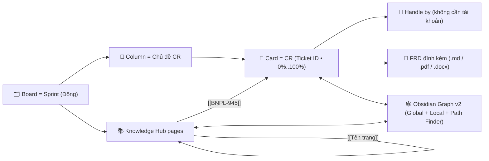
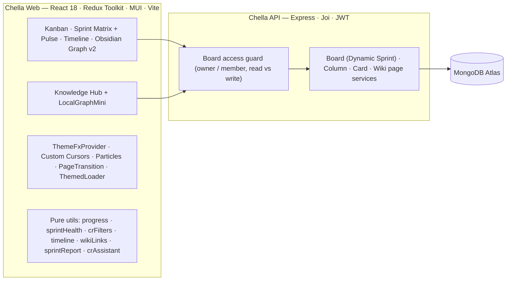

# 🌸 Chella — A clone of "C"onfluence - tr"ELL"o - jir"A"

<div align="center">


**Confluence (Knowledge Hub & FRD) × Trello (Kanban trực quan) × Jira (Sprint, CR, Timeline, Quick Filters, Report) × Obsidian (Knowledge Graph v2) — gói gọn trong một không gian làm việc nhiều chủ đề, đa ngôn ngữ.**

[🌐 Web App (Vercel)](https://chello-web.vercel.app) • [⚙️ Backend API (Render)](https://chello-api.onrender.com/v1/status) • [🧩 Backend repo](https://github.com/phuckid28/chello-api)

</div>

---

## 🚀 Có gì mới trong `v6.0.0` — *Obsidian Graph v2, Themed FX Engine & Sprint Pulse Release*

| | Tính năng | Lấy cảm hứng từ | Bạn dùng nó để… |
| :---: | :--- | :--- | :--- |
| 🕸️ | **Obsidian Knowledge Graph v2** (26 module) | Obsidian Graph View | Khám phá mạng tri thức **Global / Local Graph** (bán kính chiều sâu `1–3` bước nhảy), **ngôn ngữ truy vấn Obsidian** (`type:cr`, `status:blocking`, `assignee:"Ho Thao Dieu"`, `has:frd`, `is:orphan`, `-status:deployed` + gợi ý tự động), **Color Groups** tuỳ chỉnh, **Display & Forces** (bán kính tâm, lực đẩy, độ dài liên kết, độ dày cạnh, ngưỡng hiện nhãn, bao lồi cụm chủ đề), **Tìm đường đi ngắn nhất (Path Finder)** giữa 2 nút bất kỳ, **Time-lapse Replay** tái hiện sự hình thành mạng lưới theo thời gian, **Minimap** tương tác, **Ghim nút (Pin)** lưu theo từng Board, **Xuất ảnh PNG 2×**, và **Local Graph Mini** nhúng trực tiếp trong thanh bên Knowledge Hub. |
| 📊 | **Dev Progress `0% → 100%` (bước nhảy `10%`)** | Jira / Excel Sprint | Chọn tiến độ phát triển chính xác từ `0%, 10%, 20%, …, 100%` qua `ProgressSelect` có thanh tiến độ màu trực quan ngay trong từng tuỳ chọn; đồng bộ hoàn toàn trên thẻ Kanban, ActiveCard, CR Studio, Import Markdown/CSV và xuất báo cáo Excel/CSV (`XX%`). |
| 🖱️ | **Custom Cursors & Particle FX theo 7 Chủ đề** | Interactive Motion Design | Mỗi chủ đề (`cosmos`, `wind-chime`, `sora-sky`, `sora-twilight`, `sora-usagi`, `furina`, `nahida`) sở hữu bộ con trỏ SVG riêng (`default` + `pointer`), hạt vệt sáng theo chuột (*Cursor Trail*), tia lấp lánh khi click (*Click Sparkles*), và pháo giấy ăn mừng (*Celebration Confetti*) khi CR đạt `100%` hoặc `Deployed`. Quản lý tại `/settings/appearance`. |
| 🎬 | **Chuyển cảnh trang, Theme Reveal & Nút Loading** | View Transitions API | Thanh tiến độ chuyển route + hiệu ứng chuyển trang theo chủ đề (`PageTransition`), hiệu ứng lan toả tròn từ vị trí bấm chuột khi đổi chủ đề (`runWithReveal`), cùng `ThemedLoader` (hoạt cảnh SVG riêng cho từng chủ đề) và `LoadingButton`. |
| 💓 | **Sprint Pulse & Biểu đồ Tải Hạn Chót** | Jira Sprint Health | Đánh giá sức khoẻ kỳ Sprint thực tế so với % thời gian đã trôi qua (`Đúng tiến độ`, `Cần chú ý`, `Chậm tiến độ`, `Hoàn thành`), đếm CR quá hạn và vẽ biểu đồ phân bổ hạn chót theo từng ngày trong kỳ Sprint. |
| 🗓️ | **Kỳ Sprint Động (Dynamic Sprint)** | Thực tế quản lý Sprint | Kỳ Sprint không còn cố định là `Sprint 34`: tự động suy diễn tên/số kỳ Sprint và khung thời gian 2 tuần từ tiêu đề Board hoặc cấu hình riêng của từng Board trên cả Frontend & Backend. |
| ⌨️ | **Bảng Phím tắt (`?`)** | Obsidian / Linear | Nhấn `?` ở bất kỳ đâu để mở bảng tra cứu phím tắt cho Toàn cục, Knowledge Hub và Đồ thị Obsidian. |

> [!TIP]
> Nhấn `?` để xem bảng phím tắt, hoặc mở **Avatar → Hiệu ứng & Giao diện (`/settings/appearance`)** để xem trước con trỏ của cả 7 chủ đề và tuỳ chỉnh hiệu ứng hạt.

---

## 🧭 Mô hình làm việc



- **Sprint template 1:1 với file Excel/CSV**: `Sprint`, `Start date`, `End date`, `Update till`, `By`, `Note` • `Status`: `Processing`, `In testing`, `Blocking`, `Ready for deploy`, `Deployed`, `Done testing` • `Handle by` & `Resource point`.
- **Bảng CR**: `Ticket ID`, `CR Description`, `Status`, `Handle by`, `Due date for dev`, `Dev Progress (0% → 100%, bước 10%)`, `Resource used`, `Note` — xuất **Excel (.xls)** / **CSV** 1-click, import **.md / .csv** thành CR.
- **Team roster** lưu ngay trên board (đồng bộ mọi thiết bị) — thành viên chưa có tài khoản vẫn được gắn CR.

---

## 🧰 Các view của một Sprint Board

| View | Mục đích |
| :--- | :--- |
| **Kanban** | Kéo thả CR giữa các Chủ đề, badge Status / Priority / Due date / Dev Progress `%` / FRD / liên kết. |
| **Sprint Matrix & Pulse** | **Sprint Pulse** đo sức khoẻ tiến độ so với lịch Sprint, biểu đồ hạn chót theo ngày, bảng ma trận CR theo đúng template Excel + phân bổ `Resource point` theo người. |
| **Timeline** | Gantt theo Sprint, nhóm theo Chủ đề hoặc Handle by. |
| **Obsidian Graph v2** | Đồ thị tri thức toàn cục & cục bộ (bán kính 1–3), ngôn ngữ truy vấn Obsidian, Color Groups, điều chỉnh vật lý, tìm đường đi ngắn nhất, Time-lapse Replay, Minimap, ghim nút & xuất PNG. |
| **Knowledge Hub** | Không gian tài liệu dạng cây với `[[WikiLink]]`, Backlinks, Outgoing links và **Local Graph Mini** tương tác trực tiếp. |
| **CR Studio** | Trang riêng mô phỏng luồng CR (Happy path `200`, Business rule `409`, Timeout/Rollback `503`). |

---

## 🌐 Đa ngôn ngữ & 🎨 Chủ đề

- **4 ngôn ngữ** 🇻🇳 `VI` • 🇬🇧 `EN` • 🇯🇵 `JA` • 🇰🇷 `KO` + **chế độ Song ngữ**; thuật ngữ chuyên môn (`Sprint`, `CR`, `FRD`, `Status`, `Handle by`, `Priority`, `Timeline`, `Backlinks`…) được giữ nguyên.

| Theme | Không gian | Con trỏ & Hoạt cảnh SVG riêng | Âm thanh mặc định |
| :--- | :--- | :--- | :--- |
| `cosmos` | 🌌 Astral Cosmos • Milky Way & Zodiac | Mũi tên Tinh vân & Quỹ đạo Sao | Cosmic Astral Harmony |
| `wind-chime` | 🎐 Azure Breeze • Sky & Wind Chime | Chuông gió Furin & Làn gió xanh | Gentle Breeze & Glass Furin |
| `sora-sky` | ☁️ Sora Kasugano • Beyond the Distant Sky | Cánh chim Trời xanh & Mây trắng | *Toui Sora e* |
| `sora-twilight` | 🎀 Sora Kasugano • Moonlit Black Ribbon | Nơ lụa Ánh trăng & Sao đêm | *Inori* |
| `sora-usagi` | 🐰 Sora & Usagi • Bunny Sanctuary | Tai thỏ Usagi Hồng Pastel | *Tomadoi no Naka* |
| `furina` | 💧 Furina • Salon Solitaire & Fontaine | Vương miện Giọt nước Fontaine | *Sinner's Finale* |
| `nahida` | 🌿 Nahida • Sanctuary of Surasthana | Mầm lá Dendro Surasthana | *Sumeru Main Theme* |

---

## 🏗️ Kiến trúc



**Cấu trúc thư mục nổi bật (`v6.0.0`)**

```text
src/
├── fx/                        # ThemeFxProvider, cursorArt (7 SVG cursors), particles, PageTransition, themeReveal, fxSettings
├── components/Loading/        # ThemedLoader (7 SVG scenes), LoadingButton, PageLoadingSpinner
├── components/Modal/          # ProgressSelect (0%..100% step 10%), ImportMarkdownModal, SprintReportDialog, ActiveCard
├── components/SprintPulse/    # SprintPulse (health badge, progress vs calendar elapsed, daily deadline chart)
├── components/Shortcuts/      # ShortcutsDialog (?)
├── pages/Boards/BoardContent/KnowledgeGraph/ # 26-module Obsidian Graph v2 engine + LocalGraphMini + unit tests
├── pages/KnowledgeHub/        # KnowledgeHub, PageTree, WikiEditor, MarkdownView, LinksPanel (+ LocalGraphMini)
├── pages/Settings/            # Settings + FxSettingsPanel (/settings/appearance)
└── utils/                     # progress, sprintHealth, i18nV6, crFilters, crMeta, timeline, wikiLinks, sprintReport, crAssistant
    └── __tests__/             # Vitest unit tests (77 tests across 8 suites)
```

---

## 📜 Lịch sử phiên bản

| Phiên bản | Cột mốc | Tóm tắt |
| :--- | :--- | :--- |
| **`v6.0.0`** | **Obsidian Graph v2, Themed FX Engine, 10% Progress & Sprint Pulse** *(hiện tại)* | Đại tu **Obsidian Knowledge Graph v2** (Global/Local depth 1–3, ngôn ngữ truy vấn Obsidian, Color Groups, điều chỉnh lực vật lý, tìm đường đi ngắn nhất, Time-lapse Replay, Minimap, ghim nút, xuất PNG, nhúng `LocalGraphMini` vào Knowledge Hub); chuẩn hoá `Dev Progress` chọn từ `0%` đến `100%` mỗi bước `10%` (`ProgressSelect`); hệ thống **Custom SVG Cursors & Particle FX** theo 7 chủ đề + trang cài đặt `/settings/appearance`; `ThemedLoader`, `LoadingButton`, `PageTransition` & hiệu ứng chuyển chủ đề lan toả tròn (`runWithReveal`); **Sprint Pulse** phân tích sức khoẻ tiến độ & biểu đồ hạn chót theo ngày; **Dynamic Sprint** không còn cố định Sprint 34; hộp thoại phím tắt `?`; nâng tổng số kiểm thử lên **77 unit tests**. |
| **`v5.0.0`** | Knowledge & Delivery Release | Knowledge Hub (wiki + backlinks), Timeline view, Quick Filters, Sprint Report/Stand-up, CR Assistant, Priority & Start date, Deadline reminder, tách BoardBar thành module, lazy-loading, nén ảnh, 38 unit tests. |
| **`v4.0.0`** | Chella Rebrand, Obsidian Graph, CR Studio, 4-Lang & Cosmos/Wind-Chime | Đổi tên thành **Chella**, 4 ngôn ngữ + Song ngữ, Đồ thị Obsidian, CR Studio, 2 chủ đề mới, đồng bộ file mẫu Excel/CSV Sprint, gắn nhân sự chưa cần tài khoản. |
| **`v3.0.0`** | CR/FRD Suite & Multi-Theme OST | Quản lý CR/FRD, Import Markdown → CR, Xuất Excel Sprint, cảnh báo Deadline, chủ đề Furina & Nahida, trình phát OST. |
| **`v2.2.0`** | Sora Kasugano Edition & Motion UX | Chủ đề Sora, icon SVG, Command Palette (`Ctrl+K`), Bento Analytics, Web Audio. |
| **`v2.0.0`** | 🌟 Mốc đặc biệt: Antigravity Full-Stack Audit | Sửa lỗi kiến trúc & bảo mật, đồng bộ kéo thả, sửa stale state, xoá cột/thẻ an toàn, tối ưu deploy Vercel + Render. |
| **`v1.0.0`** | Full-Stack Social & Real-time Kanban (`PR #30`–`#41`) | Mời thành viên, bình luận, phân trang tìm kiếm board, thông báo realtime `Socket.io`, `ActiveCard` modal. |
| **`v0.5.0`** | Authentication & User Settings (`PR #20`–`#29`) | Đăng ký/đăng nhập, xác thực email, refresh token qua axios interceptor, `ProtectedRoute`, trang hồ sơ. |
| **`v0.1.0`** | Core Kanban & Drag-and-Drop (`PR #8`–`#19`) | Giao diện Kanban, `@dnd-kit`, `PlaceholderCard`, kết nối API cơ bản. |

---

## 🛠️ Chạy dự án

```bash
yarn install      # Cài dependencies
yarn dev          # http://localhost:5173
yarn lint         # ESLint (0 warning)
yarn test         # Vitest unit tests (77 tests)
yarn build        # Build production
```
