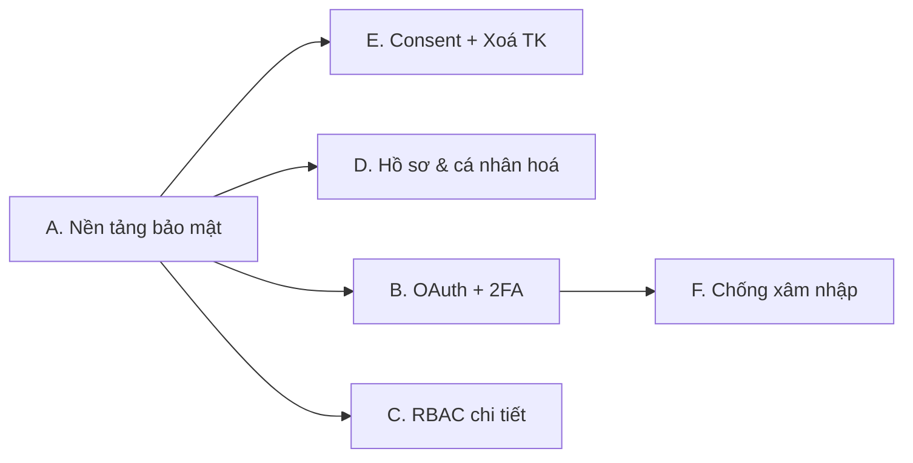

# Chella — Lộ trình nâng cấp Tài khoản, Phân quyền & Bảo mật

> Dựa trên rà soát code thực tế: [userService.js](file:///c:/Users/thanhphuc/Documents/GitHub/chello-api/src/services/userService.js), [userController.js](file:///c:/Users/thanhphuc/Documents/GitHub/chello-api/src/controllers/userController.js), [userModel.js](file:///c:/Users/thanhphuc/Documents/GitHub/chello-api/src/models/userModel.js), [authMiddleware.js](file:///c:/Users/thanhphuc/Documents/GitHub/chello-api/src/middlewares/authMiddleware.js), [userRoute.js](file:///c:/Users/thanhphuc/Documents/GitHub/chello-api/src/routes/v1/userRoute.js), [SecurityTab.jsx](file:///c:/Users/thanhphuc/Documents/GitHub/chello-web/src/pages/Settings/SecurityTab.jsx), [AccountTab.jsx](file:///c:/Users/thanhphuc/Documents/GitHub/chello-web/src/pages/Settings/AccountTab.jsx).

## 1. Hiện trạng (những gì đang có / đang thiếu)

| Hạng mục | Hiện tại | Khoảng trống |
|---|---|---|
| Đăng ký / xác thực email | Có (Brevo, link verify) | Token verify **không hết hạn**, lưu plaintext; không có "gửi lại email"; email hardcode tiếng Anh, ký tên cố định |
| Đăng nhập | Email + mật khẩu, JWT cookie httpOnly | Không khoá tạm khi sai nhiều lần (chỉ rate-limit theo IP); không có "ghi nhớ đăng nhập" |
| **Quên mật khẩu** | **Chưa có** | Thiếu hoàn toàn (forgot → email → reset) |
| Phiên (session) | JWT **stateless**, refresh 14 ngày | Không xem/thu hồi được thiết bị; đổi mật khẩu **không** vô hiệu các phiên cũ |
| Hồ sơ | `displayName` + `avatar` (URL) | `username` sinh từ email và bị khoá; trang `/users/:id` chỉ là stub 4 dòng; không upload avatar |
| Phân quyền | Global `client`/`admin`; board: owner/member | Chưa có vai trò chi tiết (Viewer/Editor/Admin) theo board; role không nằm trong token |
| Liên kết tài khoản | Chưa có | Chưa có Google/GitHub login |
| Consent / điều khoản | Chưa có | Không ghi nhận đồng ý ToS/Privacy |
| Xoá tài khoản | Chưa có (chỉ có cờ `_destroy`) | Không có luồng xoá/xuất dữ liệu |
| 2FA | Chưa có | — |
| Nhật ký bảo mật | Chưa có | Không có audit log đăng nhập/đổi mật khẩu |

### Rủi ro bảo mật phát hiện được (nên sửa sớm)
1. **CSRF**: cookie `sameSite: 'none'` ở production + xác thực bằng cookie ⇒ cần chống CSRF (kiểm tra `Origin`/header tuỳ chỉnh hoặc CSRF token).
2. **Liệt kê email (user enumeration)**: đăng ký trả `Email already exists!`.
3. **Verify token** không TTL, so sánh chuỗi thường, lưu plaintext → nên lưu hash + hạn dùng.
4. **Refresh token không thu hồi được** → lộ cookie là dùng được tới 14 ngày dù đã đổi mật khẩu.
5. Nội dung email chèn trực tiếp dữ liệu, chưa escape; link verify nằm trong `<h3>` thô.
6. `bcrypt` cost 10 (chấp nhận được, nên nâng 12 và có migration rehash khi đăng nhập).

## 2. Ý tưởng nâng cấp theo giai đoạn

### Giai đoạn A — Nền tảng bảo mật (ưu tiên cao nhất)
- **Quên / đặt lại mật khẩu**: token ngẫu nhiên 32 byte, lưu **hash SHA-256**, hết hạn 15 phút, dùng 1 lần, trả lời trung tính (không lộ email có tồn tại), email đa ngôn ngữ VI/EN/JA/KO.
- **Gửi lại email xác thực** + token có TTL 24h.
- **Quản lý phiên (Sessions/Devices)**: collection `sessions` (id, userId, hash refresh token, UA, IP, lastUsedAt). Refresh token **xoay vòng** (rotation) + phát hiện tái sử dụng. UI: danh sách thiết bị, nút "Đăng xuất thiết bị này / tất cả".
- **Đổi mật khẩu ⇒ thu hồi mọi phiên khác**.
- **Khoá tạm tài khoản**: sai 5 lần → khoá 15 phút (đếm theo tài khoản + IP), gửi email cảnh báo.
- **Chống CSRF** + chuẩn hoá lỗi đăng ký chống enumeration.
- **Nhật ký bảo mật (Audit log)**: đăng nhập, đổi mật khẩu, thiết bị mới, đổi email — hiển thị trong tab Bảo mật.
- Chỉ báo **độ mạnh mật khẩu** (zxcvbn) + kiểm tra mật khẩu bị lộ (HIBP k-anonymity, không gửi mật khẩu thật).

### Giai đoạn B — Danh tính & đăng nhập nâng cao
- **Đăng nhập Google** (OAuth2/OIDC) và tuỳ chọn **GitHub**; **liên kết / huỷ liên kết** nhiều nhà cung cấp vào một tài khoản (`identities[]`), chặn huỷ liên kết cuối cùng nếu chưa đặt mật khẩu.
- **2FA TOTP** (Google Authenticator) + **10 mã dự phòng** dùng 1 lần; bước xác nhận lại mật khẩu cho thao tác nhạy cảm (re-auth).
- **Passkey / WebAuthn** (đăng nhập không mật khẩu) — để sau 2FA.
- **Đổi email** có xác minh 2 bước (email cũ + mới).
- **Magic link** đăng nhập một lần (tuỳ chọn).

### Giai đoạn C — Phân quyền (RBAC) chi tiết
- Vai trò theo board: **Owner / Admin / Editor / Commenter / Viewer** (mở rộng `ownerIds/memberIds` → `members: [{userId, role}]`), kèm migration từ dữ liệu cũ.
- Ma trận quyền (permission matrix) tập trung ở một file, middleware `can('card:edit')` thay cho các kiểm tra rải rác.
- Vai trò toàn hệ thống: thêm `superadmin`/`moderator`; đưa `role` vào claim JWT (kèm kiểm tra DB cho thao tác nhạy cảm).
- **Link mời có hạn + vai trò mặc định**, thu hồi lời mời, trang quản lý thành viên.
- Nhật ký hoạt động theo board (ai đổi quyền ai).

### Giai đoạn D — Cá nhân hoá & Trang cá nhân
- **Trang hồ sơ `/users/:id`**: banner, avatar, bio, chức danh, múi giờ, ngôn ngữ, liên kết xã hội, thống kê (CR đã hoàn thành, sprint tham gia, trang wiki đã viết), huy hiệu.
- **Upload avatar/banner** (Cloudinary hoặc Drive bridge đã có), cắt ảnh, giới hạn kích thước/định dạng.
- **Username đổi được** (kiểm tra trùng, giới hạn đổi 1 lần/30 ngày).
- **Quyền riêng tư hồ sơ**: Công khai / Chỉ thành viên chung board / Riêng tư; ẩn email, ẩn hoạt động.
- **Tuỳ biến đồng bộ theo tài khoản** (hiện lưu local): theme, FX, ngôn ngữ, song ngữ, mật độ giao diện, phím tắt → lưu `preferences` trên server, đồng bộ nhiều thiết bị.
- **Tuỳ chọn thông báo**: kênh (in-app/email/Telegram), tần suất (tức thì/digest hằng ngày), giờ yên lặng.
- Chữ ký email/đại diện thay cho hardcode "Dao Thanh Phuc".

### Giai đoạn E — Pháp lý, Consent & Quyền dữ liệu
- **Đồng ý Điều khoản & Chính sách bảo mật** khi đăng ký (checkbox bắt buộc, không tick sẵn); lưu `consents: [{type, version, acceptedAt, ip}]`; khi phiên bản ToS đổi → yêu cầu đồng ý lại.
- **Trang ToS / Privacy / Cookie** đa ngôn ngữ + banner cookie (tách consent: cần thiết / phân tích / cá nhân hoá).
- **Xuất dữ liệu cá nhân** (JSON/ZIP: hồ sơ, board, CR, wiki) — theo tinh thần GDPR.
- **Xoá tài khoản**: xác nhận mật khẩu + gõ lại email, thời gian ân hạn 14 ngày (có thể khôi phục), sau đó ẩn danh hoá (anonymize) nội dung đã đóng góp, chuyển quyền sở hữu board hoặc yêu cầu chỉ định chủ mới. Email xác nhận/huỷ xoá.
- **Vô hiệu hoá tạm thời** tài khoản (deactivate).

### Giai đoạn F — Chống xâm nhập & giám sát
- Cảnh báo **đăng nhập từ thiết bị/vị trí mới** qua email.
- **Rate limit theo tài khoản** (không chỉ IP), backoff luỹ tiến, tuỳ chọn **CAPTCHA** (Cloudflare Turnstile) sau nhiều lần thất bại.
- Header bảo mật (đã có helmet? cần kiểm tra CSP chặt hơn), `Referrer-Policy`, `Permissions-Policy`.
- Trang **Admin Security Console**: danh sách tài khoản, khoá/mở khoá, buộc đăng xuất, xem audit log.
- Cron dọn token/sessions hết hạn; cảnh báo bất thường qua Telegram (đã có biến `TELEGRAM_*`).

## 3. Đề xuất thứ tự thực hiện

| Gói | Nội dung | Công sức | Giá trị |
|---|---|---|---|
| **1 (đề xuất làm trước)** | A + E (quên MK, phiên/thiết bị, khoá tạm, CSRF, consent, xoá/xuất dữ liệu) | Vừa | Rất cao |
| 2 | D (trang cá nhân, avatar upload, preferences đồng bộ) | Vừa | Cao |
| 3 | B (Google/GitHub, TOTP 2FA) | Lớn | Cao |
| 4 | C (RBAC theo board) | Lớn (cần migration) | Cao |
| 5 | F (admin console, cảnh báo, CAPTCHA) | Vừa | Trung bình |

## 4. Những việc cần bạn hỗ trợ (phần tôi không tự làm được)

| Tính năng | Việc của bạn |
|---|---|
| Quên MK / email cảnh báo | Hoàn tất mục 5 trước: Brevo `BREVO_API_KEY`, `ADMIN_EMAIL_ADDRESS` (email gửi đã xác minh) trên Render |
| Đăng nhập Google | Tạo **OAuth Client ID** (Google Cloud Console), khai báo redirect URI; gửi `GOOGLE_CLIENT_ID`/`SECRET` vào env Render |
| Đăng nhập GitHub | Tạo **OAuth App** trên GitHub, lấy client id/secret |
| Upload avatar | Chọn nơi lưu: Cloudinary (tạo tài khoản miễn phí) hoặc dùng Drive bridge hiện có |
| CAPTCHA | Tạo site Cloudflare Turnstile (miễn phí) |
| Nội dung pháp lý | Duyệt văn bản ToS/Privacy (tôi soạn bản nháp, bạn xác nhận) |

> [!NOTE]
> Mọi thay đổi schema (sessions, consents, members có role) sẽ có **migration an toàn, tương thích ngược** để không phá dữ liệu board/user hiện có, kèm test (RED→GREEN) và i18n đủ VI/EN/JA/KO.

> [!WARNING]
> Nên xử lý trước các rủi ro mục 1 (CSRF, thu hồi refresh token, token verify không hết hạn) vì chúng ảnh hưởng tới tài khoản thật đang chạy trên production.
