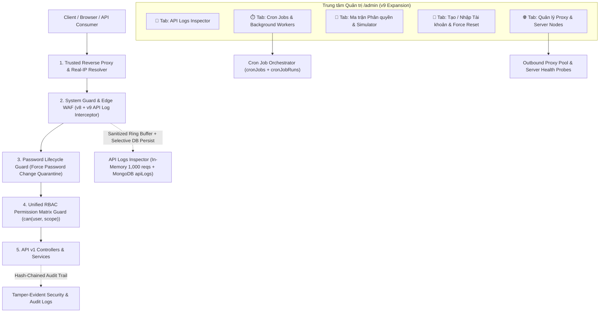
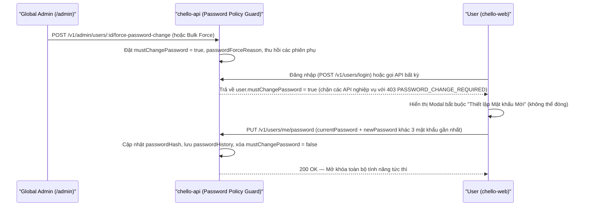

# 🛡️ Kế hoạch Kiến trúc v9: Quản trị Chuyên sâu — API Logs Inspector, Cron Job, Ma trận Phân quyền (RBAC), Force Đổi Mật khẩu, Proxy/Server & Provisioning Tài khoản

> [!IMPORTANT]
> **Trạng thái**: Đã hoàn thành triển khai, kiểm thử & đẩy lên nhánh sản xuất (`2026-11-03`).
> - **Chính sách 2FA cho Admin**: Tùy chọn theo mặc định (`enforceAdmin2fa: false`), không bắt buộc khóa Admin chưa bật 2FA.
> - **Xoay vòng API Logs (`apiLogs`)**: Tự động xóa các bản ghi log cũ nhất theo cơ chế FIFO khi chạm ngưỡng tối đa (`maxDbLogs`, mặc định `2000` bản ghi) kết hợp Ring Buffer 1.000 requests trong RAM.
> - **Force Thay đổi Mật khẩu — Phương án B**: Khi Admin kích hoạt bắt buộc đổi mật khẩu (đơn lẻ hoặc hàng loạt), hệ thống lập tức thu hồi toàn bộ phiên đăng nhập đang hoạt động (`revokeAllSessions`) để đăng xuất người dùng trên mọi thiết bị VÀ đặt `mustChangePassword = true` để buộc thiết lập mật khẩu mới (kiểm tra chống trùng `passwordHistory`) ở lần đăng nhập kế tiếp qua `ForcePasswordChangeDialog.jsx`.
> - **Chuẩn hóa Typography**: Thay thế toàn bộ font hiển thị sang `"Be Vietnam Pro", "Plus Jakarta Sans", "Noto Sans JP", sans-serif` và cố định độ rộng cột (`tabular-nums`, `nowrap`) cho bảng giám sát IP/DDoS.

---

## 1. Tổng quan Kiến trúc Hệ thống (v9 Architecture Map)

---

## 2. Thiết kế Chi tiết 6 Phân hệ Trọng tâm theo Yêu cầu

### Phân hệ 1: Monitoring API Logs (Live API Request/Response Inspector)

Hiện tại `telemetryEngine.js` mới dừng ở thống kê gộp theo phút/route/IP. Phân hệ **API Logs Inspector** cung cấp khả năng soi chi tiết từng request thời gian thực tương tự **Stripe Workbench / Cloudflare HTTP Logs / Supabase Logs**:

- **Cấu trúc bản ghi API Log (`apiLogEntry`)**:
  - `requestId`: UUID/nanoid gắn vào header `X-Request-Id` để đối chiếu lỗi giữa Frontend và Backend.
  - `timestamp`, `method`, `route` (chuẩn hóa, ví dụ `POST /v1/boards/:id/cards`), `rawPath`, `query`.
  - `statusCode`, `durationMs`, `bytesIn`, `bytesOut`.
  - `actor`: `{ userId, email, username, role, sessionId }` (nếu đã xác thực) hoặc `anonymous`.
  - `network`: `{ clientIp, remoteIp, forwardedChain, proxyTrusted, browser, os, userAgent }`.
  - `requestPreview`: Body/Query đã qua bộ lọc **PII & Secret Scrubber** (tự động che `password`, `currentPassword`, `newPassword`, `token`, `accessToken`, `refreshToken`, `totp`, `backupCode`, `secret`, `base64Data` thành `"[REDACTED]"`).
  - `error`: `{ code, message }` (nếu `statusCode >= 400`).
- **Chiến lược Lưu trữ Kép (Hybrid Storage — Tối ưu RAM & MongoDB Atlas)**:
  1. **In-Memory Ring Buffer (1.000 requests gần nhất)**: Truy vấn `< 1ms` cho chế độ **Live Tail (Stream thời gian thực)** trên giao diện Admin.
  2. **MongoDB `apiLogs` (TTL 7 ngày)**: Lưu chọn lọc theo cấu hình (`captureMode`: `'errors_and_mutations'` mặc định — lưu mọi request `4xx`/`5xx`, request chậm `> 800ms`, và các thao tác ghi `POST/PUT/PATCH/DELETE`; hoặc bật `'all'` khi cần debug sâu).
- **Tính năng trên UI (`/admin` $\rightarrow$ API Logs)**:
  - Bộ lọc đa chiều: Method (`GET/POST/PUT/DELETE`), Status (`2xx`, `4xx`, `429`, `5xx`), Route, User/Email, IP, Độ trễ tối thiểu (`> 500ms`), Từ khóa lỗi.
  - Drawer chi tiết Request: Xem Headers, Sanitized Payload, Response Metadata, nút **"Copy as cURL"** để tái hiện request, và nút **"Chặn IP này"** hoặc **"Xem User"** chỉ với 1 click.

---

### Phân hệ 2: Quản lý Cron Job & Tác vụ Nền (Cron Job Control Plane)

Nâng cấp [scheduler.js](file:///c:/Users/thanhphuc/Documents/GitHub/chello-api/src/jobs/scheduler.js) từ một `setInterval` đơn giản thành **Cron Job Orchestrator** có lưu trạng thái vào MongoDB (`cronJobs` & `cronJobRuns` với TTL 14 ngày):

| Mã Job (`jobKey`) | Tên hiển thị | Chu kỳ mặc định | Chức năng nghiệp vụ |
| :--- | :--- | :--- | :--- |
| `purge_expired_accounts` | Dọn dẹp tài khoản quá hạn ân hạn | `360m` (6 giờ) | Ẩn danh hóa và thu hồi tài nguyên của tài khoản đã quá 14 ngày chờ xóa. |
| `cleanup_expired_sessions` | Thu hồi Session & AuthToken hết hạn | `60m` (1 giờ) | Xóa các phiên đăng nhập đã hết hạn/thu hồi và OTP/Reset token rác. |
| `prune_stale_waf_and_logs` | Dọn quy tắc Auto-Ban & API Logs cũ | `30m` | Giải phóng các IP hết hạn phạt và nén thống kê telemetry. |
| `server_and_proxy_healthcheck` | Kiểm tra sức khỏe Server & Proxy | `5m` | Ping định kỳ các Server Nodes, Outbound Proxies, MongoDB, Gemini, Drive Bridge. |
| `password_expiry_and_security_audit` | Quét chính sách mật khẩu & bảo mật | `1440m` (24 giờ) | Đánh dấu `mustChangePassword` cho tài khoản quá hạn mật khẩu; phát hiện admin chưa bật 2FA. |
| `workspace_integrity_reconcile` | Đồng bộ & dọn dẹp Workspace/Board mồ côi | `720m` (12 giờ) | Kiểm tra tính toàn vẹn cây Workspace đa tầng và gán lại chủ sở hữu Board mồ côi. |

- **Quyền điều khiển của Admin trên UI**:
  - **Bật / Tắt (`enabled`)** từng Cron Job mà không cần khởi động lại server.
  - **Đổi chu kỳ chạy (`intervalMinutes`)** linh hoạt (từ `1 phút` đến `7 ngày`).
  - **Nút "Chạy ngay (Run Now)"**: Kích hoạt job tức thì, hiển thị trạng thái `running` kèm khóa chống chạy chồng (`concurrency lock`), trả về thời gian thực thi (`durationMs`), số bản ghi xử lý (`affectedCount`) và log kết quả.
  - **Auto-Circuit Breaker**: Tự động tạm dừng job và phát cảnh báo nếu lỗi liên tiếp `3 lần`.

---

### Phân hệ 3: Ma trận Phân quyền Đa tầng (RBAC Permission Matrix & Simulator)

Chuẩn hóa toàn bộ hệ thống phân quyền thành **Ma trận 3 Tầng (Global $\rightarrow$ Workspace $\rightarrow$ Board)** quản lý trực tiếp trên giao diện `/admin`:

1. **Các Vai trò Hệ thống (Global Roles)**:
   - `admin` (Super Admin — Toàn quyền hệ thống, không thể bị khóa các quyền cốt lõi).
   - `security_auditor` (Chuyên viên SOC/Kiểm toán — Chỉ có quyền xem Monitoring, API Logs, SIEM, không có quyền sửa dữ liệu người dùng).
   - `ops_manager` (Quản trị Vận hành — Quản lý Cron Job, Server/Proxy, tạo/nhập User nhưng không chỉnh sửa cấu hình WAF/RBAC gốc).
   - `client` (Người dùng tiêu chuẩn).
2. **Các Vai trò Không gian làm việc (Workspace Roles)**: `owner`, `admin`, `member`, `viewer`.
3. **Các Vai trò Bảng công việc (Board Roles)**: `admin`, `editor`, `commenter`, `viewer`.
4. **Danh mục ~30 Quyền nguyên tử (Atomic Scopes)**:
   - Nhóm **System & SOC**: `system.monitoring.view`, `system.apilogs.view`, `system.waf.manage`, `system.emergency.manage`, `system.cron.manage`, `system.proxy.manage`, `system.rbac.manage`.
   - Nhóm **User & IAM**: `user.directory.view`, `user.create`, `user.bulk_import`, `user.role.update`, `user.password.force_reset`, `user.session.revoke`, `user.status.toggle`.
   - Nhóm **Workspace**: `workspace.create`, `workspace.update`, `workspace.delete`, `workspace.member.invite`, `workspace.member.remove`, `workspace.hierarchy.move`.
   - Nhóm **Board & Knowledge**: `board.create`, `board.settings.edit`, `board.delete`, `board.column.edit`, `board.card.edit`, `board.card.comment`, `board.wiki.edit`, `board.drive.upload`, `board.ai.use`.
5. **Công cụ "Giả lập & Kiểm tra Quyền (Effective Permission Simulator)"**:
   - Admin chọn 1 User bất kỳ + (tùy chọn) 1 Workspace/Board $\rightarrow$ Hệ thống hiển thị bảng kết quả **User này được làm gì / bị chặn gì** và giải thích nguồn gốc quyền (do Global Role, do kế thừa từ Workspace cha, hay do quyền trên Board).

---

### Phân hệ 4: Force Thay đổi Mật khẩu (Mandatory Password Rotation & Quarantine)

Đáp ứng kịch bản cấp tài khoản mới, nghi ngờ lộ mật khẩu, hoặc xoay vòng mật khẩu định kỳ:

- **Các chế độ kích hoạt Force Change**:
  1. **Cá nhân (1-Click trên bảng User)**: Bắt buộc 1 người dùng đổi mật khẩu ở lần thao tác tiếp theo + tùy chọn **Đặt mật khẩu tạm thời mới (Temporary Password)** do hệ thống sinh tự động.
  2. **Hàng loạt (Bulk Action)**: Bắt buộc đổi mật khẩu cho một nhóm user được chọn, hoặc toàn bộ user có mật khẩu cũ hơn `90 ngày`, hoặc toàn bộ user chưa bật 2FA.
  3. **Chống dùng lại mật khẩu cũ (`passwordHistory`)**: Lưu tối đa 3 bcrypt hash gần nhất; khi bị force đổi mật khẩu, người dùng không thể nhập lại chính mật khẩu cũ.

---

### Phân hệ 5: Quản lý Proxy & Server (Proxy Gateway & Server Nodes Registry)

Giải quyết bài toán quản trị hạ tầng mạng, chống giả mạo IP qua Header và quản lý kết nối ra/vào:

1. **Cấu hình Inbound Reverse Proxy & Chống Spoofing IP (`trustedProxyConfig`)**:
   - Khắc phục rủi ro giả mạo header `X-Forwarded-For` bằng cách cho phép Admin cấu hình chế độ phân giải IP thực:
     - `mode`: `'cloudflare'` (ưu tiên `CF-Connecting-IP`), `'standard_proxy'` (đếm ngược theo số `trustedHops`, mặc định `1` cho Render/Vercel), `'cidr_whitelist'` (chỉ tin cậy `X-Forwarded-For` nếu remote IP nằm trong dải CIDR proxy nội bộ), hoặc `'direct'` (chỉ lấy `socket.remoteAddress`).
   - **Trình kiểm tra IP & Header trực tiếp (Live Proxy Inspector)** ngay trên UI.
2. **Quản lý Danh sách Outbound Proxy (`proxyServers`)**:
   - Thêm / sửa / xóa / bật / tắt các Proxy Server (`HTTP`, `HTTPS`) dùng để định tuyến các kết nối đi ra ngoài (Gemini AI, Google Drive Bridge, Telegram, Webhook).
   - Lưu thông tin xác thực proxy (`username`/`password`) bằng mã hóa **AES-256-GCM** (`encryptSecret`).
   - Hỗ trợ nút **"Test Proxy"** (đo độ trễ `ms` và kiểm tra kết nối thực tế) cùng chế độ dự phòng `failoverToDirect: true`.
3. **Quản lý Danh mục Server & Dịch vụ Thượng nguồn (`serverNodes`)**:
   - Cho phép đăng ký và theo dõi tập trung các máy chủ trong hệ sinh thái:
     - Mặc định tự động khởi tạo các node cốt lõi: `Chella Primary API (Render)`, `Chella Web Edge (Vercel)`, `MongoDB Atlas Cluster`, `Google Gemini AI Gateway`, `Google Drive Apps Script Bridge`.
     - Admin có thể thêm các Server Node tùy chỉnh (Staging Server, Backup Server, Self-hosted Worker, Internal API) kèm `healthCheckUrl`, `region`, `environment`, `expectedStatus`.
   - Hiển thị bảng trạng thái **Online / Degraded / Offline**, độ trễ `pingMs`, lịch sử Uptime % và nút **"Ping toàn bộ Server"**.

---

### Phân hệ 6: Tạo & Nhập Tài khoản Hàng loạt (Single & Bulk Account Provisioning)

Giúp Admin chủ động khởi tạo tài khoản cho nhân sự (BA, Dev, QA, PM) mà không cần từng người tự đăng ký và chờ xác thực email:

1. **Tạo Tài khoản Trực tiếp (Create Single Account Dialog)**:
   - Nhập `Email`, `Họ tên hiển thị (displayName)`, `Username` (tự gợi ý), `Vai trò hệ thống (role)`, `Phòng ban (department)`, `Chức vụ (jobTitle)`.
   - Tùy chọn **Gán thẳng vào Workspace** (`workspaceId` + `workspaceRole`).
   - Tùy chọn mật khẩu: **Tự sinh mật khẩu mạnh 16 ký tự** hoặc tự nhập.
   - Tùy chọn bảo mật: ✅ **Kích hoạt sẵn (`isActive: true`)**, ✅ **Bắt buộc đổi mật khẩu ở lần đăng nhập đầu tiên (`mustChangePassword: true`)**, ✅ **Gửi email chào mừng**.
2. **Nhập Tài khoản Hàng loạt (Bulk Import Wizard — CSV / Excel / JSON)**:
   - **Bước 1 — Tải file mẫu / Nhập dữ liệu**: Hỗ trợ tải file mẫu `.csv`, kéo-thả file `.csv` / `.xlsx` hoặc dán trực tiếp bảng copy từ Excel/Google Sheets.
   - **Bước 2 — Kiểm tra thử (Dry-Run Validation)**:
     - Kiểm tra định dạng email, trùng lặp trong file, trùng lặp với DB hiện có.
     - Cho phép chọn chiến lược xử lý trùng email: `Bỏ qua (Skip)` hoặc `Cập nhật vai trò & thêm vào Workspace (Upsert Membership)`.
   - **Bước 3 — Thực thi & Xuất phiếu Mật khẩu tạm**:
     - Tạo hàng loạt lên tới `200 tài khoản/lần`, tự động sinh mật khẩu ngẫu nhiên an toàn cho các dòng để trống mật khẩu, gán `mustChangePassword = true`.
     - Cho phép tải xuống **Bản báo cáo cấp phát tài khoản (`.csv`)** chứa mật khẩu khởi tạo một lần để Admin gửi cho nhân sự.

---

## 3. Đề xuất Bổ sung 6 Ý tưởng Bảo mật, Giám sát & Phân quyền Nâng cao

Qua khảo sát các nền tảng quản trị doanh nghiệp hiện đại (Okta, Atlassian Guard, Cloudflare Zero Trust, Supabase, GitHub Enterprise), tôi đề xuất tích hợp thêm **6 tính năng giá trị cao** sau vào kế hoạch:

| Mã | Tính năng đề xuất thêm | Lợi ích thực tế cho Chella | Độ phức tạp |
| :--- | :--- | :--- | :---: |
| **💡 Ý tưởng 1** | **Chuỗi Hash Chống Chỉnh sửa Log (Tamper-Evident Audit Hash Chain)** | Mỗi bản ghi sự kiện bảo mật mới sẽ băm kèm `SHA-256` của bản ghi liền trước (`prevHash` $\rightarrow$ `hash`). Có nút **"Xác minh Toàn vẹn Log"** trên UI giúp phát hiện ngay nếu DB bị can thiệp trái phép. | Nhẹ (Cao cấp) |
| **💡 Ý tưởng 2** | **Trung tâm Chính sách Mật khẩu & Phiên (Password & Session Policy Center)** | Cho phép Admin cấu hình động: Thời hạn mật khẩu tối đa (ví dụ `90 ngày`), số mật khẩu cũ không được trùng (`3`), giới hạn số thiết bị đăng nhập đồng thời mỗi user (`maxConcurrentSessions`), và bắt buộc 2FA cho mọi Admin. | Trung bình |
| **💡 Ý tưởng 3** | **Khóa API Cá nhân có Phân quyền (Scoped Personal Access Tokens - PAT)** | Cho phép tạo API Key dạng `chella_pat_...` có hạn sử dụng, giới hạn IP và chọn đúng quyền (chỉ đọc Board, chỉ tạo Card...) để phục vụ script tự động hóa/CI-CD mà không lộ tài khoản chính. | Trung bình |
| **💡 Ý tưởng 4** | **Chế độ "Kiểm tra dưới góc nhìn User" (Safe Read-Only User View / Shadow Inspector)** | Giúp Admin kiểm tra nhanh một nhân sự đang nhìn thấy những Workspace/Board nào và có quyền gì để hỗ trợ kỹ thuật (troubleshooting) mà không cần xin mật khẩu của họ. | Nhẹ |
| **💡 Ý tưởng 5** | **Phát hiện Đăng nhập Bất thường (Suspicious Login Velocity & Subnet Jump)** | Tự động phát cảnh báo SIEM khi 1 tài khoản đăng nhập từ dải mạng/thiết bị hoàn toàn lạ ngay sau nhiều lần thử sai, hoặc dùng chung phiên từ nhiều IP khác nhau cùng lúc. | Nhẹ |
| **💡 Ý tưởng 6** | **Hộp cát Giả lập Tấn công & Kiểm thử WAF (WAF & Rate-Limit Self-Test Simulator)** | Nút bấm an toàn trong `/admin` giúp Admin tự bắn thử các mẫu payload giả lập (SQLi probe, Path scan, Brute-force, Rate-limit) ở chế độ Dry-Run để kiểm증 các luật WAF/RBAC đang hoạt động đúng. | Nhẹ |

---

## 4. Thiết kế API Contract Mới (`/v1/admin/*`)

| Method & Endpoint | Mô tả |
| :--- | :--- |
| `GET /v1/admin/api-logs` | Truy vấn danh sách API Logs (lọc theo `method`, `statusGroup`, `route`, `userId`, `ip`, `minDurationMs`, `q`, `limit`), kèm thống kê phân bổ lỗi và cấu hình `captureMode`. |
| `PATCH /v1/admin/api-logs/config` | Đổi chế độ ghi API Logs (`errors_and_mutations` \| `all` \| `errors_only` \| `paused`) hoặc xóa bộ nhớ đệm log. |
| `GET /v1/admin/cron-jobs` | Lấy danh sách toàn bộ Cron Jobs kèm trạng thái chạy gần nhất và lịch sử `cronJobRuns`. |
| `PATCH /v1/admin/cron-jobs/:jobKey` | Bật/tắt (`enabled`), đổi chu kỳ chạy (`intervalMinutes`) hoặc reset bộ đếm lỗi của Cron Job. |
| `POST /v1/admin/cron-jobs/:jobKey/run` | Kích hoạt chạy thủ công ngay lập tức (`Trigger Now`) một Cron Job và trả về kết quả. |
| `GET /v1/admin/rbac/matrix` | Lấy toàn bộ định nghĩa Roles (Global, Workspace, Board), danh mục Scopes và ma trận phân quyền hiện hành. |
| `PUT /v1/admin/rbac/matrix` | Cập nhật ma trận phân quyền (bật/tắt quyền cho từng Role) hoặc khôi phục mặc định (`resetDefault: true`). |
| `POST /v1/admin/rbac/simulate` | Giả lập & giải thích quyền thực tế của 1 `userId` trên `workspaceId` / `boardId` (kèm danh sách Workspace/Board mà user đó thấy). |
| `POST /v1/admin/users/create` | Admin tạo trực tiếp 1 tài khoản mới (kèm gán Workspace, sinh mật khẩu tạm, đặt `mustChangePassword`). |
| `POST /v1/admin/users/bulk-import` | Kiểm tra thử (`dryRun: true`) hoặc thực thi (`dryRun: false`) nhập hàng loạt tài khoản từ mảng CSV/Excel/JSON. |
| `POST /v1/admin/users/force-password-change` | Bắt buộc đổi mật khẩu cho 1 hoặc nhiều user (`userIds` hoặc `filter: 'all_non_admin' \| 'expired_90d'`), tùy chọn cấp mật khẩu tạm mới. |
| `GET /v1/admin/network/overview` | Lấy cấu hình Trusted Reverse Proxy, danh sách Outbound Proxies, danh sách Server Nodes và thông tin IP/Headers của request hiện tại. |
| `PATCH /v1/admin/network/proxy-config` | Cập nhật chính sách `trustedProxyConfig` và `securityPolicy` (Password max age, History count, Max sessions). |
| `POST /v1/admin/network/proxies` | Thêm/cập nhật Outbound Proxy Server. |
| `DELETE /v1/admin/network/proxies/:id` | Xóa Outbound Proxy Server. |
| `POST /v1/admin/network/nodes` | Thêm/cập nhật Server Node / Upstream Endpoint cần giám sát. |
| `DELETE /v1/admin/network/nodes/:id` | Xóa Server Node tùy chỉnh. |
| `POST /v1/admin/network/health-check` | Chạy kiểm tra sức khỏe tức thì (HTTP Ping & Latency) cho toàn bộ hoặc 1 Server Node / Proxy. |
| `POST /v1/admin/security/verify-audit-chain` | Kiểm tra tính toàn vẹn chuỗi băm SHA-256 của nhật ký bảo mật (Ý tưởng 1). |

---

## 5. Tổ chức Giao diện Admin Console (`/admin`) & Trải nghiệm Người dùng

Để giao diện `/admin` trên `chello-web` trực quan, không bị rối khi mở rộng, thanh điều hướng Tabs sẽ được tổ chức thành **8 chuyên mục rõ ràng** (hỗ trợ cuộn ngang mượt và phím tắt):

1. **📊 Lưu lượng & Biến động (`TrafficOverviewTab`)** — *(Đã có ở v8)*
2. **🛰️ Giám sát Truy cập & DDoS (`AccessDdosTab`)** — *(Đã có ở v8)*
3. **🛡️ Bảo mật, WAF & SIEM (`SecurityWafTab`)** — *(Nâng cấp thêm xác minh Hash Chain & WAF Simulator)*
4. **📡 Nhật ký API (`ApiLogsTab` — MỚI)**:
   - Bảng Live Stream API Requests (màu hóa theo `GET/POST/PUT/DELETE` và `200/4xx/5xx`), bộ lọc đa chiều, thanh bật/tắt chế độ thu thập, và Drawer soi chi tiết Payload/Headers/cURL.
5. **⏱️ Quản lý Cron Job (`CronJobsTab` — MỚI)**:
   - Thẻ điều khiển 6 Cron Jobs hệ thống (Switch Bật/Tắt, chọn chu kỳ chạy, nút **"Chạy ngay"**, badge trạng thái) + Bảng lịch sử chạy (`cronJobRuns`).
6. **🔐 Ma trận Phân quyền (`PermissionMatrixTab` — MỚI)**:
   - Bảng lưới (Grid Matrix) trực quan: Cột là các Role (`Global`, `Workspace`, `Board`), Hàng là 30 quyền nguyên tử được gom nhóm + Công cụ **Giả lập Quyền & Xem dưới góc nhìn User**.
7. **👥 Tài khoản, Nhập liệu & Mật khẩu (`UserProvisioningTab` — MỚI)**:
   - Quản lý danh sách User nâng cao + Nút **"Tạo Tài khoản"** + Trình thuật sĩ **"Nhập Hàng loạt (CSV/Excel)"** + Nút **"Force Đổi Mật khẩu"** (cá nhân & hàng loạt) + Khung cấu hình **Chính sách Mật khẩu & Phiên**.
8. **🌐 Quản lý Proxy, Server & Khẩn cấp (`ProxyServerTab` & `EmergencyControlTab` — MỚI)**:
   - Quản lý Trusted Reverse Proxy (chống spoof IP), danh sách Outbound Proxy Pool, bảng giám sát Server Nodes (kèm nút Ping kiểm tra độ trễ), và trung tâm Cầu dao Khẩn cấp.
- **Màn hình / Modal Bắt buộc Đổi Mật khẩu (`ForcePasswordChangeDialog.jsx` — MỚI)**:
   - Tự động kích hoạt trên toàn ứng dụng (`App.jsx`) ngay khi phát hiện `currentUser.mustChangePassword === true`, hướng dẫn người dùng đổi sang mật khẩu mới an toàn trước khi thao tác tiếp.

---

## 6. Lộ trình Triển khai & Kiểm định Chất lượng (TDD & Verification)

1. **Phase 1 — Backend Core Engines (`chello-api`)**:
   - Xây dựng `apiLogEngine.js` (Ring Buffer + PII Scrubber + MongoDB persistence).
   - Xây dựng `cronManager.js` (Quản lý lịch biểu động, thực thi an toàn, lưu lịch sử `cronJobRuns`).
   - Xây dựng `rbacEngine.js` (Ma trận phân quyền 3 tầng, hàm `evaluatePermissions`, simulator).
   - Mở rộng `userService.js` & `authMiddleware.js` cho `mustChangePassword`, `passwordHistory`, tạo đơn lẻ & nhập hàng loạt (`bulkImportUsers`).
   - Xây dựng `networkControlService.js` cho Trusted Proxy, Outbound Proxies, Server Nodes & Health Check.
2. **Phase 2 — Frontend Admin Tabs & Force Password Modal (`chello-web`)**:
   - Xây dựng các Tab quản trị mới trong `src/pages/Admin/tabs/`, cập nhật `adminApi.js`, `i18nV7/admin.js` (Song ngữ Việt – Anh) và `ForcePasswordChangeDialog.jsx`.
3. **Phase 3 — Kiểm thử Tự động (Unit & Integration Tests) & Code Review**:
   - Viết đầy đủ Unit Test cho PII Scrubber, RBAC Matrix Evaluator, Password History/Force Change Guard, Bulk Import Validator, Cron Runner và Proxy Resolver.
   - Đảm bảo `0` lỗi ESLint (`--max-warnings 0`), `100%` test pass trên cả `chello-api` và `chello-web`, và build production sạch sẽ.
