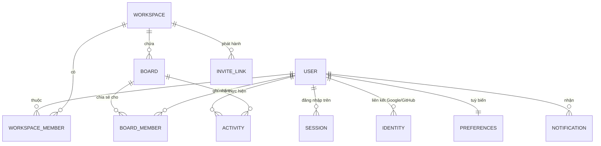
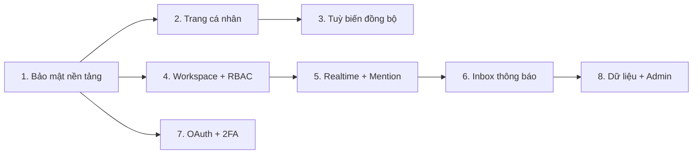

# Chella — Kế hoạch tổng thể Hệ thống Người dùng

> Phạm vi: **Tài khoản · Bảo mật · Hồ sơ cá nhân · Tuỳ biến · Workspace & Phân quyền · Cộng tác thời gian thực · Thông báo · Quyền dữ liệu**.
> Kế hoạch này kế thừa và mở rộng [account_upgrade_roadmap.md](file:///C:/Users/thanhphuc/.gemini/antigravity/brain/4bd5d320-5436-4fd1-b632-2788580d28be/account_upgrade_roadmap.md) (chưa có phần nào trong đó được triển khai).

## 0. Nguồn tham khảo đã nghiên cứu

| Chủ đề | Học từ | Áp dụng cho Chella |
|---|---|---|
| Hồ sơ cá nhân | Linear, Jira, Notion, GitHub | Header danh tính + trạng thái + giờ làm việc, widget khối lượng việc, **heatmap đóng góp**, luồng hoạt động, thẻ xem nhanh khi hover |
| Khối lượng việc | Jira Capacity, Caperity | Heatmap tải theo **story point** (không đếm số ticket), xanh/vàng/đỏ |
| Phiên đăng nhập | OWASP Session Mgmt & OAuth Cheat Sheet | Refresh token **xoay vòng + phát hiện tái sử dụng + thu hồi cả "họ token"**, lưu hash, grace period 10s |
| Phân quyền | WorkOS, Frontegg, Clerk | Tách **Identity ↔ Membership ↔ Role ↔ Permission**, 5 vai trò Owner/Admin/Member/Guest/Viewer |
| Cộng tác | Figma, Notion, Linear | Presence (avatar đang xem), con trỏ/khoá trường đang sửa, `@mention` lưu theo **userId**, hộp thư thông báo |
| Thông báo | Linear Inbox, Slack Activity, Novu | Bảng `notifications` có trạng thái unread/read/archived, phòng socket riêng mỗi user, digest email, giờ yên lặng |
| Văn hoá đo lường | DORA / SPACE | Không chấm điểm năng suất cá nhân công khai; người dùng tự bật/tắt hiển thị số liệu |

> [!NOTE]
> Nguyên tắc xuyên suốt: **đo dòng chảy công việc, không đo con người**; mặc định riêng tư, người dùng chủ động chia sẻ.

---

## 1. Hiện trạng code (đã kiểm tra)

| Thành phần | Có | Thiếu |
|---|---|---|
| [userModel.js](file:///c:/Users/thanhphuc/Documents/GitHub/chello-api/src/models/userModel.js) | email, password, username, displayName, avatar, role (client/admin), isActive, verifyToken | bio, chức danh, múi giờ, preferences, sessions, identities, 2FA, consents… |
| [userRoute.js](file:///c:/Users/thanhphuc/Documents/GitHub/chello-api/src/routes/v1/userRoute.js) | register, verify, login, logout, refresh_token, update | forgot/reset, sessions, profile công khai, search user, preferences, delete/export |
| [boardModel.js](file:///c:/Users/thanhphuc/Documents/GitHub/chello-api/src/models/boardModel.js) | `ownerIds`, `memberIds`, `teamRoster` (chuỗi tên) | vai trò theo board, roster chưa liên kết tới user thật |
| [invitationRoute.js](file:///c:/Users/thanhphuc/Documents/GitHub/chello-api/src/routes/v1/invitationRoute.js) | mời qua email + SSE stream | link mời, hết hạn, chọn vai trò, thu hồi |
| [Users/_id.jsx](file:///c:/Users/thanhphuc/Documents/GitHub/chello-web/src/pages/Users/_id.jsx) | **stub 4 dòng** | toàn bộ trang hồ sơ |
| [Settings.jsx](file:///c:/Users/thanhphuc/Documents/GitHub/chello-web/src/pages/Settings/Settings.jsx) | Account / Security / Appearance | Notifications, Sessions, Privacy, Data, Integrations |
| Theme/FX/ngôn ngữ | Lưu `localStorage` | Không đồng bộ giữa thiết bị |

---

## 2. Kiến trúc mục tiêu

### Collection mới (MongoDB)

| Collection | Trường chính |
|---|---|
| `sessions` | userId, familyId, refreshTokenHash, ua, ip, deviceName, createdAt, lastUsedAt, revokedAt |
| `authTokens` | userId, type (`verify`/`reset`/`email_change`/`magic`), tokenHash, expiresAt, usedAt |
| `workspaces` | name, slug, logo, ownerId, plan, settings (domain cho phép, mặc định vai trò) |
| `workspaceMembers` | workspaceId, userId, role, status (`active`/`invited`/`suspended`), joinedAt |
| `inviteLinks` | scope (workspace/board), scopeId, role, tokenHash, maxUses, uses, expiresAt, createdBy |
| `notifications` | recipientId, actorId, type, resource {type,id,boardId}, metadata, readAt, archivedAt |
| `activities` | actorId, boardId, cardId, verb, diff, createdAt (TTL tuỳ chọn) |
| `auditLogs` | userId, event (login, password_change, new_device, role_change…), ip, ua, createdAt |

### Mở rộng `users`
`bio, jobTitle, department, timezone, workingHours {start,end,days}, locale, bannerUrl, socialLinks[], skills[], status {emoji,text,until,mode: available|focus|meeting|ooo}, preferences {theme, fx, language, bilingual, density, shortcuts, defaultBoardView}, notificationSettings {...}, privacy {profileVisibility, showEmail, showActivity, showHeatmap}, twoFactor {enabled, secretEnc, backupCodeHashes[]}, identities[], consents[], usernameChangedAt, deletionScheduledAt`

### Board
`ownerIds/memberIds` → `members: [{userId, role}]` (giữ 2 trường cũ đọc được trong giai đoạn chuyển tiếp); `teamRoster[].userId` (tuỳ chọn) để liên kết roster với tài khoản thật.

---

## 3. Lộ trình theo giai đoạn

### Giai đoạn 1 — Nền tảng tài khoản & bảo mật *(ưu tiên cao nhất)*
| Tính năng | Chi tiết |
|---|---|
| Quên / đặt lại mật khẩu | Token 32 byte, lưu SHA-256, hết hạn 15 phút, dùng 1 lần, trả lời trung tính |
| Gửi lại email xác thực | Token TTL 24h, giới hạn 3 lần/giờ |
| Phiên & thiết bị | `sessions` + **rotation + reuse detection** (OWASP), UI danh sách thiết bị, "Đăng xuất thiết bị này / tất cả" |
| Đổi mật khẩu | Thu hồi mọi phiên khác + email thông báo |
| Khoá tạm | Sai 5 lần → khoá 15 phút theo tài khoản + IP |
| CSRF & enumeration | Kiểm tra `Origin` + header `X-Requested-With`; lỗi đăng ký trung tính |
| Nhật ký bảo mật | Tab Bảo mật hiển thị 50 sự kiện gần nhất |
| Độ mạnh mật khẩu | zxcvbn-ts + kiểm tra rò rỉ HIBP (k-anonymity) |

**API**: `POST /users/forgot_password`, `PUT /users/reset_password`, `POST /users/resend_verification`, `GET/DELETE /users/sessions/:id`, `DELETE /users/sessions`, `PUT /users/password`, `GET /users/audit_logs`
**UI**: trang `/forgot-password`, `/reset-password`, tab **Phiên đăng nhập** trong Settings.

### Giai đoạn 2 — Trang cá nhân & danh tính
| Tính năng | Chi tiết |
|---|---|
| Trang `/u/:username` | Banner + avatar + tên + chức danh + trạng thái + giờ địa phương ("14:05 · ngoài giờ làm") |
| Widget "Đang làm" | CR được giao theo Sprint, nhóm theo priority, link CR Studio |
| Heatmap đóng góp | 52 tuần, tính từ `activities` (CR hoàn thành, comment, wiki), theo màu theme hiện tại |
| Heatmap tải | 4 Sprint tới, tổng story point so với capacity |
| Luồng hoạt động | "Đã chuyển BNPL-945 sang UAT", lọc theo loại |
| Kỹ năng & sở hữu | Tag kỹ năng, board/wiki đang phụ trách |
| Thành tích | Huy hiệu (Sprint hoàn thành 100%, 10 FRD…), có thể tắt |
| Hover card | Di chuột lên avatar ở bất kỳ đâu → popover xem nhanh |
| Upload avatar/banner | Cắt ảnh (react-easy-crop), WebP, ≤ 2MB, lưu Cloudinary |
| Username đổi được | Kiểm tra trùng, 1 lần/30 ngày, redirect username cũ |
| Quyền riêng tư | Công khai / Chỉ thành viên chung / Riêng tư; ẩn email, hoạt động, heatmap |

**API**: `GET /users/:username/profile`, `GET /users/:id/activity?cursor=`, `GET /users/:id/heatmap`, `PUT /users/profile`, `POST /users/avatar`, `GET /users/search?q=` (chỉ trả user cùng workspace).

### Giai đoạn 3 — Tuỳ biến đồng bộ & trạng thái
| Tính năng | Chi tiết |
|---|---|
| Preferences trên server | Theme, FX, ngôn ngữ, song ngữ, mật độ, view mặc định, phím tắt → `PUT /users/preferences`; localStorage chỉ còn là cache |
| Trạng thái cá nhân | Emoji + text + hết hạn; chế độ **Focus** (tắt toast/âm thanh, đồng bộ Pomodoro có sẵn), Meeting, OOO |
| Giờ làm việc & múi giờ | Cảnh báo nhẹ khi `@mention` người ngoài giờ |
| Onboarding | 4 bước sau đăng ký: chọn theme → ngôn ngữ → tạo/nhập workspace → mời đồng đội; có checklist |
| Trang chủ cá nhân "My Work" | Gộp CR của tôi trên mọi board, deadline sắp tới, mention chưa đọc |

### Giai đoạn 4 — Workspace, thành viên & phân quyền (RBAC)
**Vai trò workspace**: Owner · Admin · Member · Guest · Viewer
**Vai trò board**: Admin · Editor · Commenter · Viewer

| Quyền | Owner | Admin | Member | Guest | Viewer |
|---|:-:|:-:|:-:|:-:|:-:|
| Xoá / chuyển workspace | ✅ | | | | |
| Mời / gỡ thành viên, đổi vai trò | ✅ | ✅ | | | |
| Tạo board | ✅ | ✅ | ✅ | | |
| Sửa CR / wiki | ✅ | ✅ | ✅ | board được chia sẻ | |
| Bình luận | ✅ | ✅ | ✅ | ✅ | |
| Xem | ✅ | ✅ | ✅ | board được chia sẻ | ✅ |

- Ma trận quyền tập trung trong `src/utils/permissions.js` (dùng chung API + web), middleware `requirePermission('card:edit')`.
- Web: hook `useCan('card:edit')` để ẩn/khoá nút.
- **Link mời** có vai trò + hạn dùng + số lượt, thu hồi được; giới hạn domain email.
- Trang **Quản lý thành viên**: bảng tìm kiếm, đổi vai trò, tạm khoá, gỡ, chuyển quyền sở hữu.
- **Migration**: `ownerIds → role admin`, `memberIds → role editor`; script idempotent + rollback.

### Giai đoạn 5 — Cộng tác thời gian thực
| Tính năng | Chi tiết |
|---|---|
| Hạ tầng | **Socket.IO** (thay SSE hiện tại), phòng `user:{id}` và `board:{id}`, xác thực bằng cookie JWT khi handshake |
| Presence | Dãy avatar "đang xem" trên BoardBar, chấm xanh/vàng (idle 5 phút) |
| Đang sửa | Khoá mềm theo trường: "Phúc đang sửa mô tả…", hiển thị viền màu người đó trên thẻ |
| Cập nhật trực tiếp | Kéo thả card, đổi status, progress đồng bộ tức thì (thay cho refetch) |
| `@mention` | Trong comment, mô tả CR, wiki; lưu `{type:'mention', userId}`; gợi ý theo thành viên board |
| Bình luận nâng cao | Luồng trả lời, reaction emoji, chỉnh sửa/xoá, đánh dấu đã giải quyết |
| Người theo dõi (watcher) | Theo dõi CR/board để nhận thông báo |
| Lịch sử thay đổi | Activity log theo card/board, xem diff mô tả, khôi phục phiên bản wiki |
| Đồng soạn wiki *(tuỳ chọn, sau cùng)* | Yjs + y-mongodb-provider cho Knowledge Hub |

> [!WARNING]
> Render free tier ngủ sau 15 phút và chỉ 1 instance → socket sẽ rớt khi API ngủ. Chấp nhận được cho giai đoạn đầu; nếu mở rộng nhiều instance cần Redis adapter.

### Giai đoạn 6 — Trung tâm thông báo
- **Inbox** (thay [Notifications.jsx](file:///c:/Users/thanhphuc/Documents/GitHub/chello-web/src/components/AppBar/Notifications/Notifications.jsx) hiện tại): tab *Tất cả / Mention / Được giao / Lời mời*, đánh dấu đã đọc, lưu trữ, nhóm theo CR.
- **Loại sự kiện**: được giao CR, mention, comment trên CR đang theo dõi, đổi status, deadline còn 24h, được mời, đổi vai trò.
- **Tuỳ chọn theo từng loại × kênh**: In-app / Email / Telegram (đã có `TELEGRAM_*`) / Web Push.
- **Digest email** hằng ngày/tuần, **giờ yên lặng** theo múi giờ người dùng.
- Mẫu email đa ngôn ngữ VI/EN/JA/KO, escape dữ liệu, có link huỷ đăng ký.

### Giai đoạn 7 — Đăng nhập nâng cao
- Google / GitHub OAuth (PKCE + state), liên kết/huỷ liên kết nhiều nhà cung cấp.
- **2FA TOTP** + 10 mã dự phòng; re-auth cho thao tác nhạy cảm.
- **Passkey (WebAuthn)** với `@simplewebauthn`.
- Đổi email xác minh 2 phía; magic link tuỳ chọn.

### Giai đoạn 8 — Quyền dữ liệu & quản trị
- Đồng ý ToS/Privacy khi đăng ký (lưu phiên bản), banner cookie.
- **Xuất dữ liệu** (ZIP JSON: hồ sơ, board, CR, wiki, comment).
- **Xoá tài khoản**: xác nhận MK + gõ email, ân hạn 14 ngày, ẩn danh hoá nội dung ("Người dùng đã xoá"), buộc chuyển quyền board.
- **Admin Console**: danh sách user, khoá/mở, buộc đăng xuất, audit log, thống kê đăng ký.
- Cloudflare Turnstile sau nhiều lần thất bại; cảnh báo đăng nhập thiết bị mới.

---

## 4. Thứ tự đề xuất & ước lượng

| Gói | Giai đoạn | Công sức | Giá trị | Ghi chú |
|---|---|---|---|---|
| **A** | 1 | 2–3 phiên làm việc | Rất cao | Sửa rủi ro bảo mật đang chạy production |
| **B** | 2 + 3 | 3–4 phiên | Rất cao | Thấy ngay trên UI, cần chọn nơi lưu ảnh |
| **C** | 4 | 3–4 phiên | Cao | Có migration dữ liệu board |
| **D** | 5 + 6 | 4–5 phiên | Cao | Đổi SSE → Socket.IO |
| **E** | 7 | 2–3 phiên | Trung bình–cao | Cần OAuth credentials |
| **F** | 8 | 2–3 phiên | Trung bình | Cần duyệt văn bản pháp lý |

Mỗi gói: test RED→GREEN (Vitest web + thêm Jest/Vitest cho API), i18n 4 ngôn ngữ, 0 cảnh báo ESLint, review bảo mật bằng `ecc-security-reviewer`, deploy Vercel + Render.

---

## 5. Việc cần bạn chuẩn bị

| Gói | Việc của bạn |
|---|---|
| A | Xác nhận `BREVO_API_KEY` + email gửi đã xác minh trên Render |
| B | Tạo tài khoản **Cloudinary** (miễn phí) → `CLOUDINARY_URL`, hoặc chọn dùng Drive bridge có sẵn |
| D | Không cần gì thêm (Render hỗ trợ WebSocket) |
| E | Google OAuth Client ID/Secret, GitHub OAuth App |
| F | Duyệt bản nháp ToS/Privacy; tạo site Cloudflare Turnstile |

## 6. Câu hỏi mở cần bạn quyết định
1. **Mô hình tổ chức**: thêm tầng **Workspace** (nhiều board thuộc một workspace, như Jira/Linear) hay giữ phân quyền **chỉ theo board** (đơn giản hơn, như Trello)?
2. **Heatmap & số liệu cá nhân**: hiển thị công khai cho thành viên chung hay chỉ bản thân thấy?
3. **Ảnh đại diện**: Cloudinary hay Google Drive bridge?
4. **Gói bắt đầu**: đề xuất **A → B**, hay bạn muốn ưu tiên phần nhìn thấy được (B) trước?
